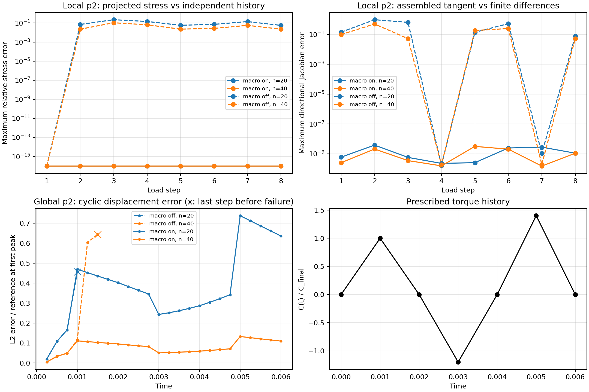

# SBM: confronto delle due versioni esistenti con storia ciclica

Test eseguiti il 16 ottobre 2026. **I risultati sostengono la necessità della
storia indipendente al punto proiettato nella formulazione attuale.** Il ramo
senza macro presenta inoltre una tangente non consistente. Il confronto globale
non separa questi due effetti, perché il macro esistente li cambia entrambi.
Non dimostra quindi che ogni formulazione alternativa senza storia al true sia
impossibile, né che il macro garantisca sempre la convergenza.

Non sono state implementate altre varianti della condition. Le due librerie
temporanee provengono dallo stesso sorgente, cambiando soltanto lo stato di
`SBM_USE_PROJECTION_POINT_CONSTITUTIVE_LAW`. Sorgente Kratos, libreria installata,
project parameters e materiale di produzione non sono stati modificati.



## Configurazione congelata

Gli input effettivi sono salvati in
[parameters_input.json](diagnostics/cyclic_projection/parameters_input.json) e
[materials_input.json](diagnostics/cyclic_projection/materials_input.json).

- SBM mixed: Dirichlet esterno, Neumann interno, proiezione `analytical`.
- `lambda_inner=0.0`, `lambda_outer=0.5`, `PENALTY_FACTOR=-1`.
- E=67000, nu=0, snervamento iniziale 201, H=10000.
- Strategia `line_search`, massimo 100 iterazioni e tolleranze del JSON corrente.
- `ANALYTICAL_TANGENT` disattivo in entrambe le build.
- Test globale: passo temporale 0.00025, tempo finale 0.006, 24 passi.
- Identità del sorgente e delle librerie temporanee in
  [build.json](diagnostics/cyclic_projection/build.json).

## Test locale: storia e Jacobiano della condition

Sono state provate due mesh (20 e 40 spans per direzione), p=1 e p=2,
otto load conditions distribuite lungo il bordo e otto passi di deformazione
non proporzionale: carico, scarico, rotazione, inversione e ricarico.
Le deformazioni imposte derivano da coefficienti spazialmente non affini.

Due punti materiali indipendenti ricevono esattamente `B_s*u` e `B_true*u`.
Il confronto non confonde quindi l'errore di storia con la troncatura di Taylor.
Un terzo punto indipendente usa la deformazione proiettata in fase trial e
committa quella del surrogate: ricostruisce il comportamento del ramo off senza
implementare un'altra condition.

Per ogni stato si confrontano RHS e LHS assemblate con le risposte indipendenti,
si controlla la derivata della RHS con differenze finite centrali e si inseriscono
trial scartati per verificare che non vengano committati. La selezione del nodo
proiettato dalla skin è verificata indirettamente dall'accordo delle risposte
assemblate con la ricostruzione indipendente.

Risultati con hardening lineare, p=2; massimi sugli otto punti e otto passi:

| Macro | Mesh | Errore relativo stress true rispetto alla storia indipendente | Errore direzionale Jacobiano / FD |
|---|---|---:|---:|
| on | 20×20 | 0, alla precisione del confronto | 3.78e-9 |
| on | 40×40 | 0, alla precisione del confronto | 3.09e-9 |
| off | 20×20 | 0.2208 | 0.9926 |
| off | 40×40 | 0.1061 | 0.5138 |

Nel ramo on RHS e LHS concordano con la costruzione indipendente entro 1.83e-14
e 3.62e-15 rispettivamente, con la normalizzazione salvata nei record.
I trial scartati non cambiano la RHS ripetuta: errore zero in entrambe le versioni.

Nel **primo passo**, quando le storie sono entrambe vergini, il ramo off dà ancora
lo stesso stress true del riferimento, ma il Jacobiano è già non consistente:
errore massimo 0.1455 sulla mesh 20 e 0.0994 sulla mesh 40. Dal passo successivo
compare anche l'errore di storia. Il massimo errore di stress si manifesta durante
lo scarico, al passo 3.

Per p=1, in questo test con mappa geometrica identità, l'estensione del gradiente
non aggiunge termini: `B_true=B_s`. Entrambi i rami superano il controllo locale;
errore FD massimo 1.71e-8 con hardening lineare. Questo controllo spiega perché
p=1 sia poco discriminante rispetto alla gestione della storia proiettata.

## Test globale: torsione ciclica con forcing nullo

La coppia prescritta segue i livelli

```
tempo:       0    .001  .002   .003  .004  .005  .006
C/C_final:   0      1     0    -1.2     0   1.4     0
```

Il riferimento mantiene `tau_rtheta=C(t)/r²` e forcing nullo, ma accumula
correttamente deformazione plastica equivalente e deformazione tangenziale
plastica **con segno**. Lo scarico conserva lo spostamento residuo. Non si
riutilizza la formula monotona sostituendo semplicemente un tempo decrescente.
Gli incrementi plastici all'inversione iniziano quando il modulo della coppia
supera il massimo precedente, come richiesto dall'hardening isotropo.

Il riferimento è stato verificato contro un integratore scalare indipendente
(errore 5.56e-17), contro le derivate numeriche dello spostamento (1.17e-11)
e contro la legge Kratos completa lungo 121 passi a sei raggi (errore assoluto
di stress massimo 6.26e-13). Dati in
[reference_validation.json](diagnostics/cyclic_projection/reference_validation.json).

| Grado | Mesh | Macro on | Macro off |
|---|---|---|---|
| p1 | 20×20 | completa 24 passi | completa 24 passi |
| p2 | 20×20 | completa 24 passi | fallisce a t=0.00125, primo scarico |
| p2 | 40×40 | completa 24 passi | fallisce a t=0.00175, durante il primo scarico |

Sulla mesh 40, off converge ancora ai primi due passi di scarico, ma l'errore di
stress cresce da 0.0485 al picco a 1.3554 nel primo passo di scarico, normalizzato
con lo stress di riferimento al primo picco. La sola convergenza di Newton non
certifica quindi la risposta corretta.

Anche il ramo on conserva un errore spaziale apprezzabile: al termine del ciclo,
l'errore L2 normalizzato con la norma dello spostamento esatto **al primo picco**
è 0.6359 sulla mesh 20 e 0.1095 sulla mesh 40. La normalizzazione fissa evita
rapporti instabili quando la coppia torna a zero. Questi sono due controlli di
mesh, non uno studio sistematico dell'ordine di convergenza.

Il controllo globale p1 è piuttosto inaccurato su questa mesh grossolana:
errore finale circa 0.90–0.92 con la stessa normalizzazione. I due rami non danno
risultati globali identici dopo l'inversione; il controllo locale p1 coincide
entro arrotondamento. Non si usa quindi p1 come evidenza di accuratezza globale.

## Controllo aggiuntivo: hardening esponenziale

Sono state eseguite anche 512 valutazioni locali totali tra le due versioni con
la legge già disponibile `sigma_y=201+10000*alpha+149*(1-exp(-80*alpha))`.
La condition con macro on riproduce le due leggi indipendenti anche in questo
caso, ma la tangente del **materiale stesso** non supera le differenze finite.
Questo risultato non può essere interpretato come un difetto della condition.

Un punto materiale vergine, senza assembly SBM, in puro taglio con gamma=0.02 dà:

| Quantità | Legge Kratos installata | Return mapping scalare indipendente |
|---|---:|---:|
| tau | 116.0474 | 203.3058 |
| alpha | 0.0095470 | 0.0080432 |

La tangente a taglio restituita è 4489.71; la derivata numerica dello stress è
circa -0.000566, stabile in ordine di grandezza per passi FD da 1e-6 a 1e-8.
Il residuo della superficie di snervamento aggiornata è -175.05.
Lo stesso controllo con H lineare soddisfa snervamento e tangente.

Il sorgente `small_strain_j2_plasticity_3d.cpp`, in
`GetAccumPlasticStrainRate`, valuta `GetSaturationHardening` con
`AccumulatedPlasticStrainOld` dentro il ciclo Newton, mentre la derivata usa
`accumulated_plastic_strain` aggiornata. Nel ramo non lineare il residuo viene
quindi risolto mantenendo congelata la resistenza precedente. La versione 2D
usata qui richiama questo integratore ereditato. Non è stata applicata alcuna
correzione. Nessuna conclusione di convergenza globale viene tratta dal caso
esponenziale.

## Riproduzione e dati

Dal repository:

```bash
python3 AnnulusPlasticity/diagnostics/cyclic_projection/run.py
```

Il comando ricompila soltanto due librerie in `/tmp/sbm_cyclic_projection`, carica
ciascuna con `LD_PRELOAD` in un processo separato, esegue i controlli e salva i log.
Congela nuovamente gli input correnti: per riprodurre esattamente questa esecuzione
devono coincidere con le copie salvate. I fallimenti dei solve sono registrati
in `result.json`; i controlli locali di corrispondenza hanno assert espliciti.
Le anomalie FD del materiale esponenziale restano risultati diagnostici registrati.

- [Riepilogo numerico](diagnostics/cyclic_projection/summary.json)
- [Stati locali, macro on](diagnostics/cyclic_projection/local_on.json)
- [Stati locali, macro off](diagnostics/cyclic_projection/local_off.json)
- [Controllo materiale isolato](diagnostics/cyclic_projection/material_control.json)
- [Verifica input e sorgente invariati](diagnostics/cyclic_projection/production_unchanged.json)
- [Riferimento ciclico](diagnostics/cyclic_projection/reference.py)
- [Script per rigenerare solo il grafico](diagnostics/cyclic_projection/summarize.py)
