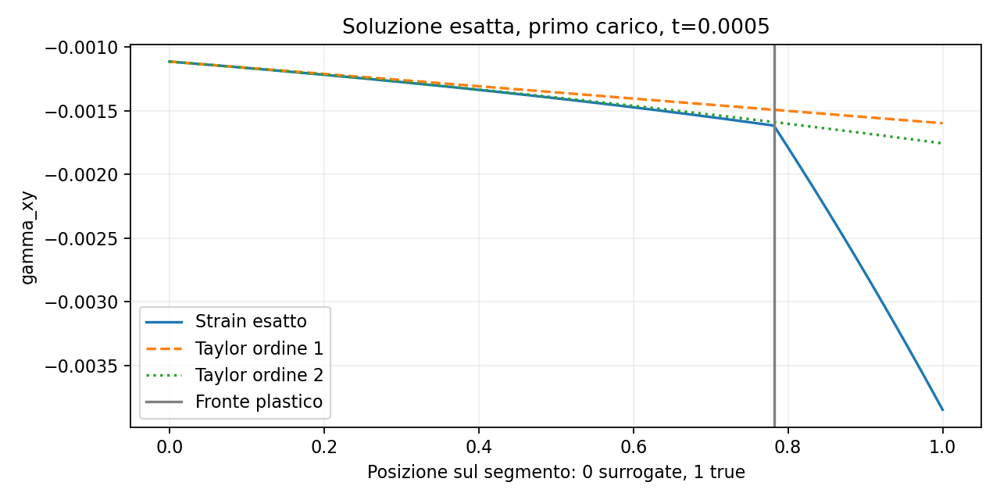

# Regolarità dello strain e Taylor sulle coppie salvate

`python3 AnnulusPlasticity/diagnostics/strain_taylor_regularity/check.py`

Audit della **soluzione esatta**, senza solve Kratos, sulle coordinate delle coppie
20×20 e 40×40 salvate nell'audit `sbm_p3_pair_phases`. Le coppie sono quelle delle
condition di Neumann interne. Non identifica i fronti del campo numerico iterativo.
Sorgente e libreria attuali hanno hash diversi dall'audit precedente: questi dati
non costituiscono un nuovo test di Newton con la libreria attuale.

Durante il primo carico, con C(t)>0:

    gamma(r) = C/(G*r²) + sqrt(3)/H * max(sqrt(3)*C/r² - sigma_y, 0)
    rp = sqrt(sqrt(3)*C/sigma_y)

La deformazione di taglio ingegneristica gamma è continua, ma

    gamma'_plastico(rp) - gamma'_elastico(rp) = -6*C/(H*rp³).

Quindi lo strain è Lipschitz e analitico a tratti, non C1 al fronte. Non esiste
una derivata seconda classica globale continua. La tensione esatta C/r² è invece
liscia nel dominio dell'anello.

Il programma valuta lo strain cartesiano esatto e il suo Taylor **unilaterale**
all'origine surrogate, di ordine q=0,1,2, in direzione del true. Le derivate
sono ottenute simbolicamente dalla formula analitica, non mediante differenze
finite. Errore relativo = norma euclidea del vettore di Voigt ingegneristico
[epsilon_xx, epsilon_yy, gamma_xy] divisa per la norma esatta al true.
È una misura diagnostica, non la norma energetica.

| Tempo | Raggio fronte | Attraversamenti 20×20 | Attraversamenti 40×40 |
|---|---:|---:|---:|
| 0.00025 | 0.750000 | 0/280 | 0/560 |
| 0.00050 | 1.060660 | 280/280 | 352/560 |
| 0.00075 | 1.299038 | 0/280 | 0/560 |

Nel run di riferimento 0.0005 converge e 0.00075 fallisce. Al passo fallito tutte
le coppie sono interamente nel ramo plastico della soluzione esatta; quindi
non attraversano la sua perdita di regolarità. Questo non esclude fronti
numerici differenti durante Newton o effetti della storia del passo precedente.

Per i segmenti che attraversano il fronte a t=0.0005, gli errori relativi mediani
q=1 / q=2 sono 55.3% / 53.2% (mesh20) e 53.9% / 52.9% (mesh40).
Il Taylor del ramo elastico non riproduce il cambio di pendenza attraversato.
A t=0.00075, senza attraversamento, gli stessi errori sono invece
11.5% / 2.11% e 3.38% / 0.331%: aggiungere l'ordine 2 migliora questa
ricostruzione analitica, pur essendo il passo numerico non convergente.

Separatamente, 144/280 e 264/560 segmenti attraversano almeno una linea di knot
interna della griglia uniforme [-2.2,2.2] (nessuna conclusione sul campo esatto
segue da questo fatto). Con spline p3 a knot semplici u_h è C2 e lo strain_h C1,
ma le seconde derivate dello strain_h possono saltare ai knot. Il Taylor del
polinomio locale è un'estensione di quel polinomio, non necessariamente il valore
della spline globale su un altro span. Attraversare knot non rende di per sé
invalida un'estensione SBM: occorre misurarne errore e stabilità.

Output: `pairs.csv`, `summary.json`, `strain_segment.png`.
