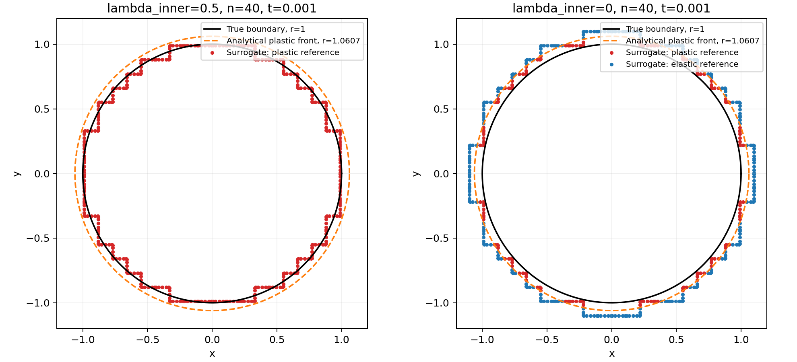

# SBM p2: prova con lambda_inner=0.0

## Perché era possibile surrogate plastico / true elastico

L'aspettativa sulla soluzione esatta è corretta: il cerchio vero interno r=1
è interamente plastico già al primo step, t=0.001. In particolare:

- il bordo inizia a snervare a t=0.002/1.5²=0.000888889;
- a t=0.001, q_true=226.125 > 201 e alpha_true=0.0025125;
- a t=0.002, q_true=452.25 e alpha_true=0.025125.

Gli otto true elastici osservati nel ciclo della mesh 40 appartengono invece
a un **iterato numerico non convergente**. La legge al true riceve
`epsilon_true=B_sum*u_numerico`, non la deformazione analitica. Durante il
ciclo questa deformazione può risultare sotto snervamento, anche se quella
esatta non lo è. La trazione analitica prescritta non impone direttamente
alla legge il ramo plastico in ogni iterato.

Per quegli otto punti a t=0.001 la storia precedente è nulla, come pure la
deformazione plastica trial al true: **in quel caso specifico non è scarico
elastico**. È una discrepanza del campo numerico rispetto al riferimento.
Il possibile scarico di punti già plasticizzati è un fenomeno distinto.

## Confronto controllato

Sono stati rilanciati gli stessi casi con lambda_inner=0.5 e 0.0, mantenendo:

- p2, proiezione `analytical`, lambda_outer=0.5;
- **PENALTY_FACTOR=-1**, come nel materiale corrente al momento della prova;
- H=10000, E=67000, nu=0, yield=201;
- dt=0.001, due step, massimo 100 iterazioni e tolleranze originali.

Questo confronto non va confuso con quello precedente, svolto con penalità
positiva 6700000. Gli input congelati sono in `diagnostics/lambda_inner_zero`.
I due valori di lambda sono stati variati soltanto nelle copie diagnostiche.

## Risultati con line search

| Mesh | lambda_inner=0.5 | lambda_inner=0.0 | L2 relativo con lambda=0 |
|---|---|---|---:|
| 20×20 | Converge, L2=0.08531 | Converge, 7 e 8 iterazioni | 0.44527 |
| 40×40 | Fallisce a t=0.001 | Converge, 6 e 8 iterazioni | 0.11386 |
| 80×80 | Fallisce a t=0.002 | Converge, 7 e 9 iterazioni | 0.03038 |

Quindi lambda=0 elimina i fallimenti su queste tre mesh **con line search**,
ma non è un miglioramento uniforme dell'accuratezza: sulla mesh 20 l'errore
passa da 8.53% a 44.53%. La serie lambda=0 scende da 44.53% a 11.39% a 3.04%
raffinando 20→40→80.

La mesh 40 è stata controllata anche con **Newton puro**: fallisce al primo
step sia con lambda=0.5 sia con lambda=0.0. Non è quindi una soluzione
generale al problema di convergenza indipendentemente dalla strategia.

Il solve lambda=0, mesh 40, con la libreria installata non strumentata produce
esattamente lo stesso esito, numero di iterazioni ed errore L2 della prova
strumentata. Non è un effetto della diagnostica.

## Cambiamento geometrico effettivo

Intervalli dei raggi dei punti di quadratura delle condizioni Neumann:

| Mesh | lambda=0.5 | lambda=0.0 |
|---|---|---|
| 20 | 0.90964–1.11981 | 1.10005–1.27753 |
| 40 | 0.93704–1.04193 | 1.01528–1.13002 |
| 80 | 0.97480–1.03637 | 1.00408–1.06645 |

Nelle mesh provate, lambda=0 porta il surrogato interno **interamente fuori
dal foro vero**, r_s>1, modificando il dominio bulk e il verso della distanza
di proiezione per i punti prima interni al cerchio. Non equivale a porre
uguale a zero la distanza surrogate–true.

Al primo step il fronte plastico analitico è r_p=sqrt(1.125)=1.06066.
Con lambda=0 il surrogate può essere oltre questo fronte, quindi
**surrogate elastico / true plastico è perfettamente compatibile con il
riferimento**. Per la mesh 20, tutti i 200 punti surrogate sarebbero elastici
nel riferimento a t=0.001; per la mesh 40 sono 248 su 400, per la 80 sono
32 su 760. Questi sono conteggi del campo analitico, non dei rami numerici.



## Regimi numerici osservati

Con lambda=0 e line search, nello stato convergente del primo step:

- mesh 20: 16 coppie surrogate elastico / true plastico; le altre entrambe plastiche;
- mesh 40 e 80: entrambe le risposte plastiche in tutte le coppie;
- al secondo step tutte le coppie sono plastiche su entrambi i punti, nelle tre mesh.

Il ciclo sugli otto punti P_s/E_t della mesh 40, presente con lambda=0.5,
non compare nel solve convergente lambda=0 con line search. Con Newton puro,
lambda=0 presenta ancora cambi di ramo e non raggiunge l'equilibrio.

Il confronto dei regimi analitici e numerici, insieme agli errori riportati,
conferma che il successo Newton non basta per validare l'accuratezza del caso.

## File pronti

- `sbm/ProjectParameters_mixed_lambda_inner_0.json`: copia della configurazione
  corrente, con **la sola modifica lambda_inner=0.0**. Il JSON mixed principale
  e il generatore non sono stati cambiati.
- `diagnostics/lambda_inner_zero/summary.json`: esiti e conteggi delle otto prove.
- Nelle rispettive cartelle: `parameters.json`, `result.json`, `geometry.json`,
  `iterations.csv`, `pairs.csv` e i campioni `solution.npz` dei solve completati.
- `run_case.py`, `summarize.py` e `plot_geometry.py`: worker e postprocessing.
- `baseline_uninstrumented`: controllo con la libreria installata originale.

Dalla cartella `AnnulusPlasticity/sbm`, per ripetere il confronto lambda=0:

```bash
python3 convergence.py --degree 2 --boundary mixed \
  --parameters ProjectParameters_mixed_lambda_inner_0.json \
  --refinements 20 40 80
```
