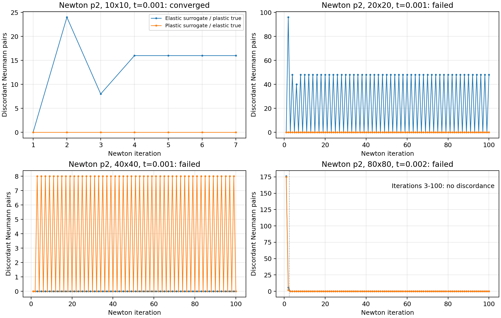

# Discordanza elastico/plastico fra surrogate e true: SBM p2

## Risposta

**Non c'è una corrispondenza univoca fra discordanza e mancata convergenza.**
Nei cicli delle mesh 20 e 40 si osserva effettivamente un cambio ripetuto di
regime delle stesse coppie Neumann. Tuttavia:

- la mesh 10 converge anche con 16 coppie discordanti all'equilibrio del primo step;
- la mesh 80 con Newton puro fallisce al secondo step, pur avendo entrambe
  le risposte plastiche in tutte le 720 coppie, dall'iterazione 3 alla 100.

Quindi la discordanza può accompagnare uno specifico ciclo, ma la sua sola
presenza non è sufficiente a prevedere il fallimento; una discordanza persistente
non è neppure necessaria per tutti i fallimenti osservati.

## Configurazione e metodo

Nuove prove del 16 ottobre 2026, con gli input correnti congelati:

- SBM mixed, p2, proiezione `analytical`;
- lambda inner/outer=0.5;
- E=67000, nu=0, yield=201, H=10000;
- **PENALTY_FACTOR=6700000** nel materiale corrente;
- dt=0.001, due step, massimo 100 iterazioni e tolleranze originali;
- `line_search` nel JSON corrente; prove separate con override `newton_raphson`.

I precedenti `failures.json` non sono stati usati come esito delle nuove
simulazioni: si riferiscono a run precedenti e a Newton puro. Qui i casi sono
stati rilanciati con la configurazione congelata. File e hash sono in
`diagnostics/regime_mismatch_current/{parameters_input.json,materials_input.json,source_info.json}`.

Una copia della `SbmLoadSolidCondition` è stata strumentata e compilata soltanto
in `/tmp`, senza modificare Kratos installato. Si leggono direttamente le due
leggi costitutive in ogni assembly LHS, oltre a uno snapshot finale dello step
convergente o fallito, **prima di qualsiasi commit delle storie**. Il controllo
riguarda le condizioni Neumann, che possiedono due leggi indipendenti.

Sono state controllate due nozioni distinte:

1. **Ramo attivo:** elastico se `||D_alg-D_el||_F/||D_el||_F <= 1e-8`,
   plastico altrimenti. Per questa legge J2 a proprietà costanti distingue
   il ramo elastico dal return mapping plastico.
2. **Già plasticizzato:** deformazione plastica equivalente trial maggiore
   di 1e-12. Si registrano anche le deformazioni plastiche committate precedenti.
   Un punto con storia plastica può trovarsi in scarico elastico: non va
   confuso con un punto che non ha mai plasticizzato.

L'esito e il numero esatto di iterazioni sono stati verificati anche senza
strumentazione per tre controlli: mesh 10 con line search, mesh 20 con Newton
puro e mesh 40 con line search. Coincidono con le prove strumentate.

## Newton puro

`E_s/P_t` indica surrogate elastico e true plastico; `P_s/E_t` il contrario.
I conteggi delle iterazioni ordinarie sono misurati prima della correzione
Newton. Lo snapshot finale è misurato dopo l'ultima correzione.

| Mesh | Esito | Comportamento delle coppie Neumann |
|---|---|---|
| 10×10 | Converge a t=0.002 | Al primo step converge con **16 E_s/P_t su 80**. Al secondo step entrambe plastiche in tutte le coppie. |
| 20×20 | Fallisce a t=0.001 | Le ultime iterazioni alternano **48 E_s/P_t e zero discordanti**, sugli stessi 48 punti. Lo snapshot finale ha entrambe plastiche in tutti i 200 punti, ma il ciclo non è risolto. |
| 40×40 | Fallisce a t=0.001 | Le ultime iterazioni alternano **8 P_s/E_t e zero discordanti**, sugli stessi 8 punti, su 360 coppie. |
| 80×80 | Fallisce a t=0.002 | **Dall'iterazione 3 alla 100 tutte le 720 coppie hanno entrambi i rami plastici**, senza discordanza. Lo stesso vale nello snapshot finale. |

Per la mesh 80, all'inizio del secondo step ci sono discordanza del ramo attivo
e risposte vicino allo snervamento; queste scompaiono dopo le prime due
iterazioni. Il mancato raggiungimento dell'equilibrio prosegue invece fino
al limite di 100 iterazioni. La deformazione plastica accumulata non va
identificata con questa breve discordanza del ramo attivo.



## Line search, configurazione corrente del JSON

| Mesh | Esito | Coppie discordanti nello stato convergente del primo step |
|---|---|---:|
| 10×10 | Converge, 6 / 23 iterazioni nei due step | 16 E_s/P_t |
| 12×12 | Converge, 7 / 12 iterazioni | 8 E_s/P_t |
| 16×16 | Converge, 20 / 15 iterazioni | 8 E_s/P_t |
| 20×20 | Converge, 14 / 11 iterazioni | 0 |
| 30×30 | Converge, 7 / 10 iterazioni | 0 |
| 40×40 | Fallisce al primo step, 100 iterazioni | Ciclo 8 P_s/E_t ↔ 0 |
| 80×80 | Converge, 7 / 22 iterazioni | 0 |

Tutti i casi completati hanno entrambe le risposte plastiche in tutte le
coppie nello snapshot finale a t=0.002. Questo non è un controllo dell'errore
spaziale: "converge" qui significa superare il criterio non lineare.

Nelle prove convergenti la discordanza non è soltanto transitoria: sulle mesh
10, 12 e 16 è presente anche nello stato di equilibrio del primo step.
È ammissibile che il fronte plastico attraversi il segmento fra surrogate e true.
Il comportamento problematico osservato sulle mesh 20 e 40 è l'alternanza
persistente del ramo durante Newton, non semplicemente avere due punti in
regimi diversi.

## Dati e riproducibilità

Cartella: `diagnostics/regime_mismatch_current`.

- `summary.json`: esiti delle 11 prove strumentate e conteggi per step.
- `iterations.csv`: conteggi completi per iterazione, con indicatore degli
  snapshot finali.
- `current/n*/pairs.csv` e `newton_raphson/n*/pairs.csv`: identificativi,
  coordinate, rami attivi e deformazioni plastiche di ogni coppia.
- `run_case.py`: worker che rilegge gli input congelati e registra gli snapshot.
- `instrumentation.patch`: sole aggiunte diagnostiche al sorgente Kratos.
- `summarize.py`, `plot_regimes.py`: rigenerazione di riepiloghi e figura.
- `baseline_uninstrumented`: controlli con la libreria installata originale.

Con la libreria diagnostica ancora disponibile in `/tmp`, ad esempio:

```bash
LD_PRELOAD=/tmp/sbm_regime_audit/libKratosIgaCore.so \
  python3 AnnulusPlasticity/diagnostics/regime_mismatch_current/run_case.py \
  --mesh 20 --strategy newton_raphson
python3 AnnulusPlasticity/diagnostics/regime_mismatch_current/summarize.py
```

La diagnosi supporta un ruolo del cambio di ramo in alcuni cicli, ma non
consente di attribuire tutti i fallimenti alla discordanza E/P del bordo.
Non è stata applicata alcuna modifica al solver, alle leggi o agli input
di produzione.
