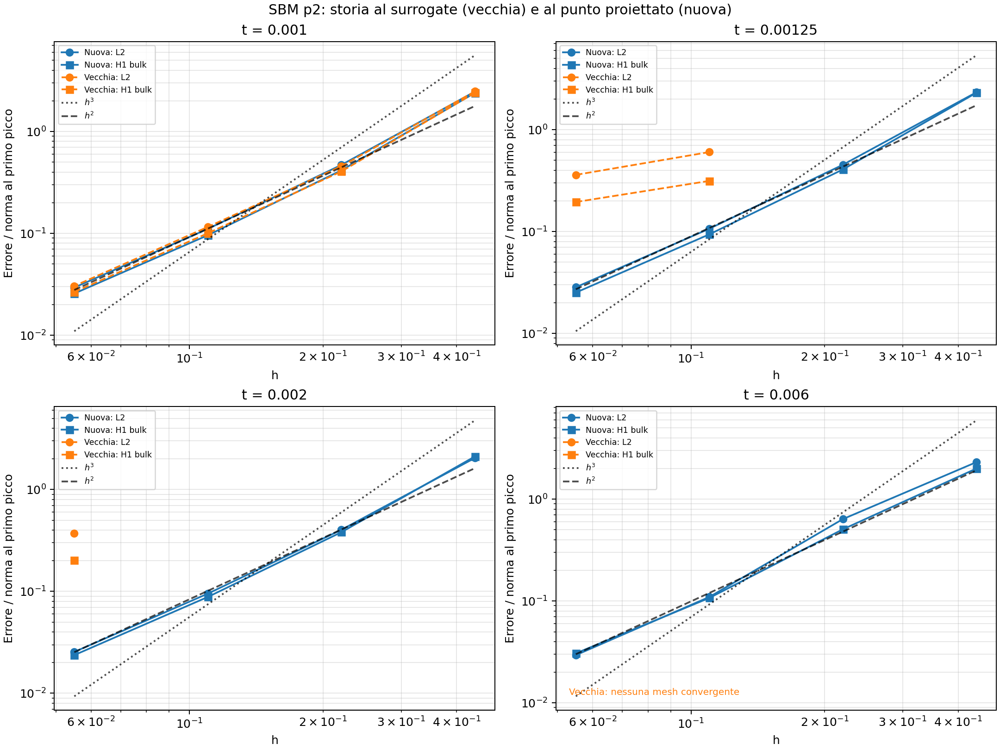
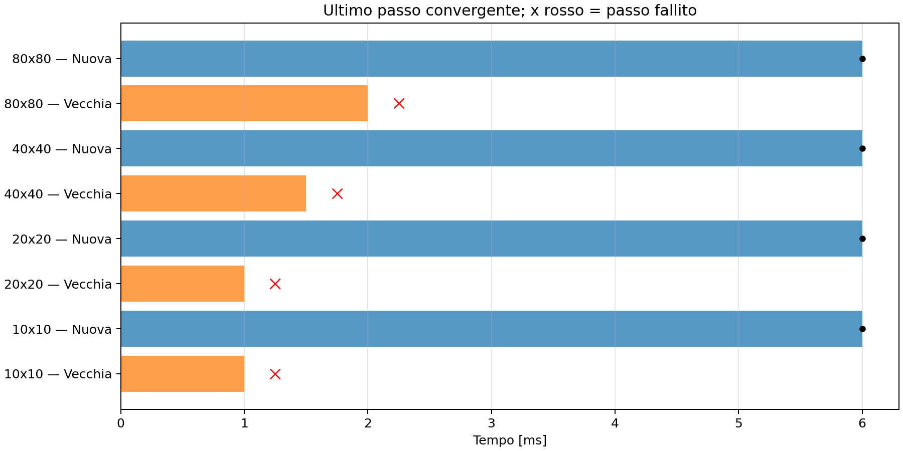

# SBM p2: confronto ciclico tra i due rami della SbmLoadSolidCondition

Test eseguito il 18 ottobre 2026 sulle mesh 10, 20, 40 e 80 spans per direzione.
La definizione operativa di **vecchia** è il ramo del codice corrente con
`SBM_USE_PROJECTION_POINT_CONSTITUTIVE_LAW` disattivato; **nuova** è lo stesso
codice con il macro attivo.

La nuova versione completa tutti i cicli. La vecchia si arresta durante lo
scarico o all'inizio dell'inversione. Nei passi che entrambe completano, gli
errori sono simili al primo picco ma divergono nettamente durante lo scarico.



## Configurazione e isolamento

- SBM mixed, grado p=2, line search e massimo 100 iterazioni.
- dt=0.00025, tempo finale 0.006: 24 passi.
- E=67000, nu=0, snervamento iniziale 201, hardening isotropo lineare H=10000.
- Penalty=-1, lambda_inner=0, lambda_outer=0.5; quadratura bulk di default.
- Forcing volumetrico nullo e percorso della coppia
  `0 -> 1 -> 0 -> -1.2 -> 0 -> 1.4 -> 0`.
- Override `ANALYTICAL_TANGENT` disattivi nei sorgenti del bulk e delle
  condition SBM esaminati.

Sono state compilate due librerie diagnostiche in `/tmp/sbm_cyclic_old_vs_new`,
usando gli stessi comandi e oggetti della build corrente. Tra i due sorgenti
compilati cambia soltanto la riga del macro; la geometria e le altre correzioni
sono comuni. Ogni prova carica la propria libreria in un processo separato con
`LD_PRELOAD` e lavora in una cartella isolata.

La libreria installata, i sorgenti Kratos e gli input di produzione sono
rimasti invariati. Per ciascuna mesh sono stati confrontati parametri, materiale
e tipi/numero delle entità runtime: coincidono tra le due versioni, salvo il
percorso della copia del materiale nei parametri salvati.

Copie degli input, checksum e verifiche:
[build.json](diagnostics/sbm_cyclic_old_vs_new/build.json),
[fairness_checks.json](diagnostics/sbm_cyclic_old_vs_new/fairness_checks.json),
[execution.json](diagnostics/sbm_cyclic_old_vs_new/execution.json).

## Robustezza del ciclo

| Mesh | Vecchia: ultimo tempo convergente | Vecchia: tempo di arresto | Nuova |
|---|---:|---:|---|
| 10×10 | 0.001, 4 passi | 0.00125 | completa 24 passi |
| 20×20 | 0.001, 4 passi | 0.00125 | completa 24 passi |
| 40×40 | 0.0015, 6 passi | 0.00175 | completa 24 passi |
| 80×80 | 0.002, 8 passi | 0.00225 | completa 24 passi |



Il punto fallito non viene usato per misurare errori o pendenze. Il suo tempo è
registrato come arresto; i tempi successivi rimangono non raggiunti.
Non si tenta di continuare il ciclo dopo un passo non convergente.

## Accuratezza negli stessi stati di carico

Gli errori seguenti sono L2 normalizzati con la norma della soluzione analitica
al primo picco. La normalizzazione resta la stessa durante scarichi e inversioni.

Al primo picco, t=0.001:

| Mesh | Vecchia | Nuova |
|---|---:|---:|
| 10×10 | 2.48026 | 2.46948 |
| 20×20 | 0.457112 | 0.470277 |
| 40×40 | 0.115810 | 0.110747 |
| 80×80 | 0.0304722 | 0.0294116 |

Gli errori in questa fase sono simili; la vecchia è leggermente più accurata
sulla mesh 20. Il test non mostra un miglioramento uniforme a ogni mesh e tempo.

Dopo il primo scarico, t=0.00125:

| Mesh che raggiungono il tempo con entrambe | Vecchia | Nuova | Rapporto vecchia/nuova |
|---|---:|---:|---:|
| 40×40 | 0.603532 | 0.106795 | 5.65 |
| 80×80 | 0.360391 | 0.0284154 | 12.68 |

A coppia nulla, t=0.002, la mesh 80 dà **0.372819** nella vecchia versione e
**0.0254756** nella nuova: rapporto **14.63**. In entrambi i casi questo passo
ha soddisfatto i criteri di Newton. La convergenza del solve da sola non certifica
quindi l'accuratezza della risposta durante lo scarico.

A t=0.002 la vecchia ha una sola mesh disponibile; non si può stimare un ordine
spaziale a quel tempo. Dal primo picco invertito t=0.003 in poi non ha alcuna
mesh disponibile tra quelle provate.

La nuova arriva al tempo finale con L2 pari a 2.31270, 0.638122, 0.109773 e
0.0294485. Nell'ultimo raffinamento 40→80 la pendenza è circa **1.90 in L2** e
**1.81 in H1 bulk**. Su queste mesh il test non dimostra l'ordine L2 teorico p+1=3.
Le reference line h² e h³ sono riportate nei grafici.

## Come sono usati i cicli parziali

Il postprocessore include tutti i passi convergenti, anche se il ciclo si arresta
successivamente. L'errore rispetto a h e le pendenze vengono calcolati separatamente
per ciascun tempo e versione, usando solo le mesh che hanno raggiunto quel tempo.
I rapporti vecchia/nuova usano soltanto coppie con stessa mesh e stesso tempo.

Sono presenti 118 stati convergenti complessivi: 96 nuovi e 22 vecchi. Ci sono
22 coppie confrontabili. I massimi su storie di durata diversa non vengono
confrontati. Tutti gli arresti sono fallimenti numerici registrati dal solver;
non ci sono processi terminati con errori infrastrutturali.

Il controllo automatico del postprocessore verifica con un caso sintetico che
un ciclo interrotto contribuisca soltanto ai tempi raggiunti e che non venga
stimata una pendenza con un solo punto.

## Portata del risultato

Il confronto sostiene l'utilità della versione attiva per questo caricamento
ciclico. Il macro cambia **sia la storia costitutiva usata al punto proiettato
sia la tangente del relativo termine nella LHS**. Queste prove confrontano i due
rami complessivi e non separano i due effetti.

## File e riproduzione

- [Grafico principale](diagnostics/sbm_cyclic_old_vs_new/comparison.png)
- [Otto istanti di carico](diagnostics/sbm_cyclic_old_vs_new/convergence_by_time.png)
- [Errori di tutti i passi convergenti](diagnostics/sbm_cyclic_old_vs_new/errors_by_time.csv)
- [Confronti alle stesse mesh e tempi](diagnostics/sbm_cyclic_old_vs_new/comparison.csv)
- [Pendenze a tempi fissati](diagnostics/sbm_cyclic_old_vs_new/slopes_by_time.csv)
- [Tempi raggiunti e arresti](diagnostics/sbm_cyclic_old_vs_new/availability.csv)

Per ripetere il test con gli input correnti:

```bash
python3 AnnulusPlasticity/diagnostics/sbm_cyclic_old_vs_new/run.py
```

Per estenderlo alle mesh più fini, senza cambiare i default del runner principale:

```bash
python3 AnnulusPlasticity/diagnostics/sbm_cyclic_old_vs_new/run.py --refinements 10 20 40 80 160 320
```

Per rigenerare solo tabelle e grafici dai risultati del confronto:

```bash
python3 AnnulusPlasticity/diagnostics/sbm_cyclic_old_vs_new/postprocess.py
```
