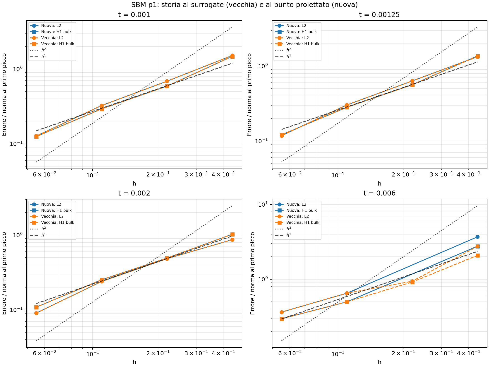

# SBM p1: confronto tra implementazione vecchia e nuova nel caso ciclico

Test eseguito il 18 ottobre 2026 sulle mesh 10, 20, 40 e 80.
Sono stati riutilizzati gli input congelati del [confronto p2](sbm_cyclic_old_vs_new_check.md),
cambiando soltanto il grado in p1. Restano dt=0.00025, line search, H=10000,
penalty=-1, lambda_inner=0 e lambda_outer=0.5. La quadratura è quella di default
della geometria; il suo ordine dipende dal grado.

La versione vecchia è il ramo senza `SBM_USE_PROJECTION_POINT_CONSTITUTIVE_LAW`;
la nuova ha il macro attivo. Le due librerie diagnostiche differiscono soltanto
per questo macro e sono caricate in processi separati. La libreria installata,
i sorgenti Kratos, i parametri di produzione e i risultati p2 restano invariati.

## Esito dei cicli

| Mesh | Vecchia | Nuova |
|---|---|---|
| 10×10 | completa 24 passi | completa 24 passi |
| 20×20 | completa 24 passi | fallisce a t=0.00525, dopo 20 passi |
| 40×40 | completa 24 passi | completa 24 passi |
| 80×80 | completa 24 passi | completa 24 passi |

L'arresto a t=0.00525 è il primo passo dello **scarico finale**, dopo il ricarico
positivo al picco 1.4 a t=0.005. La prova nuova sulla mesh 20 è stata ripetuta
in una cartella separata: esito, errori temporali e conteggi delle iterazioni
coincidono esattamente con la prima esecuzione.



## Errori e interpretazione

Errori L2 al tempo finale t=0.006, normalizzati con la norma analitica al primo
picco, come nel confronto p2:

| Mesh | Vecchia | Nuova |
|---|---:|---:|
| 10×10 | 2.75229 | 3.69078 |
| 20×20 | 0.940730 | non disponibile |
| 40×40 | 0.650597 | 0.650597 |
| 80×80 | 0.363588 | 0.363588 |

La soluzione nuova sulla mesh 20 arriva a t=0.005 con errore L2 0.717765;
questo valore non viene confrontato con lo stato finale della vecchia, perché
sono tempi diversi. I suoi primi 20 passi entrano invece nei grafici ai tempi
raggiunti. Complessivamente sono disponibili 188 stati convergenti e 92 coppie
confrontabili alla stessa mesh e allo stesso tempo.

Sulla mesh 80 gli errori L2 delle due versioni coincidono entro circa 2e-14 in
termini relativi durante tutto il ciclo. Sulla mesh 40 lo scarto relativo massimo
tra gli errori L2 è circa 2.8e-5 e lo stato finale coincide entro arrotondamento.
Sulle mesh grossolane 10 e 20 si osservano invece differenze dopo l'inversione.
Sulla mesh 20 gli errori coincidono entro arrotondamento fino a t=0.003, poi
divergono insieme ai conteggi delle iterazioni di Newton.

Per p1, nella `SbmLoadSolidCondition`, l'estensione del gradiente non aggiunge
termini Taylor di ordine superiore. Con la mappa di background identità,
le matrici B del surrogate e del punto proiettato coincidono in aritmetica esatta.
La ricostruzione sulle 120 load conditions della mesh 20 dà differenza relativa
massima **1.76e-15**; il Jacobiano geometrico differisce dall'identità per al più
2.67e-15. Il controllo è salvato in
[kinematics.json](diagnostics/sbm_cyclic_old_vs_new_p1/kinematics.json).

Il confronto p1 è quindi meno discriminante rispetto alla gestione di due storie
costitutive distinte. I risultati non mostrano un vantaggio sistematico della
nuova versione con questo grado. La discrepanza sulle mesh grossolane e il
fallimento riproducibile della nuova sulla 20 richiederebbero una diagnosi
numerica dedicata; questo test non ne identifica la causa. Non vengono attribuiti
automaticamente a una differenza fisica tra storia al true e al surrogate.

Nell'ultimo raffinamento 40→80, al tempo finale, le pendenze sono circa 0.84
in L2 e 0.75 in H1 bulk per entrambe le versioni. Queste mesh non dimostrano
l'ordine L2 p+1=2. I grafici riportano le reference line h e h².

## File e riproduzione

- [Grafico principale](diagnostics/sbm_cyclic_old_vs_new_p1/comparison.png)
- [Otto istanti di carico](diagnostics/sbm_cyclic_old_vs_new_p1/convergence_by_time.png)
- [Tempi raggiunti e arresti](diagnostics/sbm_cyclic_old_vs_new_p1/availability.png)
- [Errori alle stesse mesh e tempi](diagnostics/sbm_cyclic_old_vs_new_p1/comparison.csv)
- [Pendenze a tempi fissati](diagnostics/sbm_cyclic_old_vs_new_p1/slopes_by_time.csv)
- [Riepilogo](diagnostics/sbm_cyclic_old_vs_new_p1/summary.json)
- [Verifiche degli input e della ripetizione](diagnostics/sbm_cyclic_old_vs_new_p1/fairness_checks.json)

Il driver ora accetta il grado e separa automaticamente gli output p1 da quelli p2:

```bash
python3 AnnulusPlasticity/diagnostics/sbm_cyclic_old_vs_new/run.py --degree 1
```

Per rigenerare soltanto grafici e tabelle p1:

```bash
python3 AnnulusPlasticity/diagnostics/sbm_cyclic_old_vs_new/postprocess.py --output AnnulusPlasticity/diagnostics/sbm_cyclic_old_vs_new_p1
```

I due test del postprocessore verificano l'uso dei soli passi convergenti a tempi
uguali e la selezione delle reference line corrette per p1.
