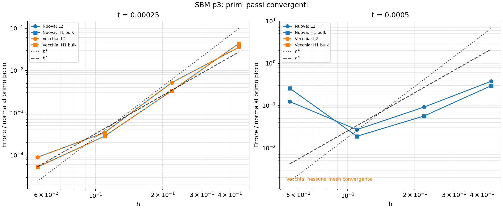

# SBM p3: confronto ciclico tra implementazione vecchia e nuova

Prova eseguita il 18 ottobre 2026 sulle mesh 10, 20, 40 e 80, con gli stessi
input congelati dei confronti [p2](sbm_cyclic_old_vs_new_check.md) e
[p1](sbm_cyclic_old_vs_new_p1_check.md). Cambia soltanto il grado, impostato a 3.
Restano dt=0.00025, line search, massimo 100 iterazioni, H=10000, penalty=-1,
lambda_inner=0 e lambda_outer=0.5. La quadratura è quella di default della
geometria, dipendente dal grado. Il ciclo previsto termina a t=0.006 in 24 passi.

La versione vecchia disattiva `SBM_USE_PROJECTION_POINT_CONSTITUTIVE_LAW`;
la nuova lo attiva. Sono state ricompilate due librerie temporanee che differiscono
soltanto per questo macro. I sorgenti Kratos e la libreria installata restano
invariati; i loro hash coincidono anche con quelli usati nel confronto p2.
Nessuna variante della condition è stata aggiunta.

## Esito

| Mesh | Vecchia: passo fallito | Nuova: passo fallito |
|---|---:|---:|
| 10×10 | t=0.0005 | t=0.00075 |
| 20×20 | t=0.0005 | t=0.00075 |
| 40×40 | t=0.0005 | t=0.00075 |
| 80×80 | t=0.0005 | t=0.00075 |

La vecchia completa soltanto il primo passo, a t=0.00025; la nuova completa
anche il secondo, a t=0.0005. Nessuna mesh raggiunge il primo picco a t=0.001.
Gli arresti avvengono quindi durante il **primo carico positivo**, prima di
scarico e inversione. Non ci sono fallimenti di compilazione o dei processi:
gli otto arresti sono mancata convergenza del solver.



Errori L2 normalizzati con la norma analitica al primo picco:

| Mesh | t=0.00025, entrambe | t=0.0005, solo nuova |
|---|---:|---:|
| 10×10 | 0.0356123 | 0.377453 |
| 20×20 | 0.00520126 | 0.0925353 |
| 40×40 | 0.000343073 | 0.0271067 |
| 80×80 | 0.0000897020 | 0.124712 |

Al primo passo gli errori delle due versioni coincidono esattamente. Al secondo
passo, disponibile solo per la nuova, l'errore peggiora passando dalla mesh 40
alla 80: anche H1 bulk aumenta da 0.0189516 a 0.257183. Il fatto che il solver
converga in quel passo non dimostra quindi una convergenza spaziale regolare.

Sono disponibili 12 stati convergenti e soltanto 4 coppie vecchia/nuova allo
stesso tempo e alla stessa mesh. I grafici conservano i soli passi completati;
non vengono calcolate norme sugli stati non convergenti. Le reference line sono
h³ e h⁴. I grafici standard ai picchi del ciclo non contengono punti, perché
nessuna simulazione raggiunge tali istanti: per questo è aggiunto il grafico
dei primi passi. Questi risultati non permettono un confronto sull'intero
ciclo né identificano la causa degli arresti p3.

## Dati e riproduzione

- [Primi passi convergenti](diagnostics/sbm_cyclic_old_vs_new_p3/initial_convergence.png)
- [Tempi raggiunti e arresti](diagnostics/sbm_cyclic_old_vs_new_p3/availability.png)
- [Tabella degli arresti](diagnostics/sbm_cyclic_old_vs_new_p3/availability.csv)
- [Errori a tutti i tempi disponibili](diagnostics/sbm_cyclic_old_vs_new_p3/errors_by_time.csv)
- [Confronto agli stessi tempi](diagnostics/sbm_cyclic_old_vs_new_p3/comparison.csv)
- [Verifiche degli input](diagnostics/sbm_cyclic_old_vs_new_p3/fairness_checks.json)
- [Sorgenti e libreria installata invariati](diagnostics/sbm_cyclic_old_vs_new_p3/execution.json)

Per ripetere il test, mantenendo separati i risultati p1 e p2:

```bash
python3 AnnulusPlasticity/diagnostics/sbm_cyclic_old_vs_new/run.py --degree 3
```

Per rigenerare soltanto i grafici:

```bash
python3 AnnulusPlasticity/diagnostics/sbm_cyclic_old_vs_new/postprocess.py --output AnnulusPlasticity/diagnostics/sbm_cyclic_old_vs_new_p3
```

Verificati i parametri effettivamente usati: ordine [3,3], stessi parametri,
materiali e conditions per le due versioni su ogni mesh. I due test esistenti
del postprocessore passano anche dopo l'aggiunta del grafico dei primi passi.
