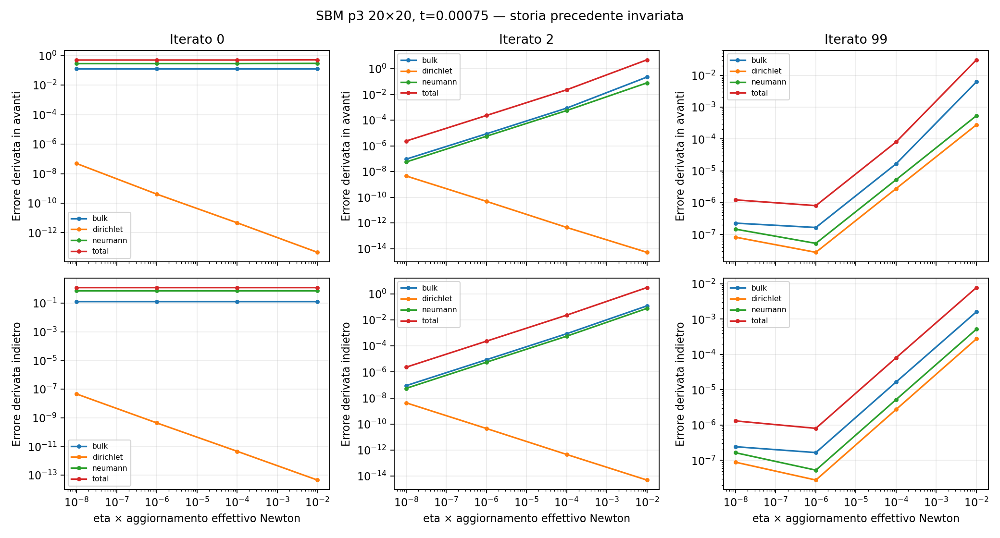
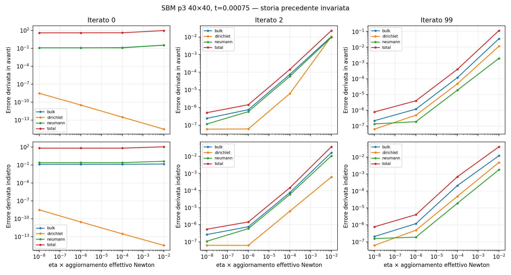
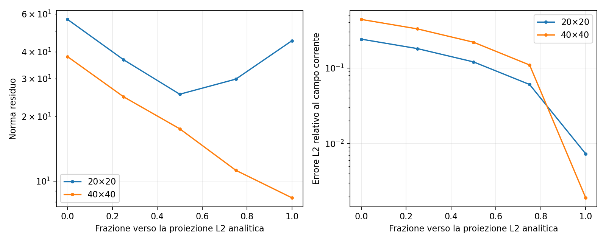

# SBM p3: derivata direzionale e riavvio dalla proiezione analitica

Controlli sulla condition originale, senza modifiche C++ né al solver nativo:
mesh20 e mesh40, p3, mixed ciclico, dt=0.00025, H=10000, penalty-free,
lambda_inner=0, line search. Legge al projection point attiva, Taylor corrente
q=2 nello strain. Sorgente e libreria identificati dagli hash in
[build.json](diagnostics/sbm_p3_directional_warm_start/build.json).

Il riferimento converge ai primi due passi e fallisce a t=0.00075, dopo 100
iterazioni. I primi due passi accettati coincidono esattamente con il precedente
baseline. I controlli si fermano a t=0.00075, senza alterare il percorso del carico
prima di quel tempo.

## 1. Derivata lungo l'aggiornamento effettivo di Newton

Dagli iterati salvati dalla strategia nativa si prende d=u_(k+1)-u_k, cioè
l'aggiornamento **dopo** line search. Con la convenzione Kratos K=-dR/du,
si confrontano:

    F_eta = [R(u + eta*d) - R(u)] / eta
    B_eta = [R(u) - R(u - eta*d)] / eta
    errore avanti = ||F_eta + K*d|| / ||K*d||

Ogni perturbazione mantiene la stessa storia consolidata a t=0.0005. Sono
controllati l'inizio del passo (k=0), k=2 e k=99, con eta=1e-2,1e-4,1e-6,1e-8.
L'assembly è separato in volume, Dirichlet e Neumann; le matrici delle due
condizioni sono assemblate direttamente e sottratte al totale per ottenere
il contributo del volume.

All'inizio del passo, errori relativi in avanti con eta=1e-6:

| Mesh | Volume | Dirichlet | Neumann | Totale |
|---|---:|---:|---:|---:|
| 20×20 | 0.1248 | 4.1e-10 | 0.2834 | 0.4952 |
| 40×40 | 0.1206 | 3.3e-11 | 0.1218 | 38.0167 |

Questi sono rapporti, non percentuali: 0.4952 equivale al 49.52%; 38.0167 a
circa 3802%. La discrepanza non scompare riducendo eta: a 1e-8 il totale è
0.495194 e 38.023528. La derivata indietro è diversa: 1.205534 e 66.639681.

Il forte rapporto globale sulla mesh40 è amplificato dalla cancellazione:

| Mesh | ||K_volume*d|| | ||K_Dirichlet*d|| | ||K_Neumann*d|| | ||K_totale*d|| |
|---|---:|---:|---:|---:|
| 20×20 | 66.34 | 28.53 | 59.00 | 37.21 |
| 40×40 | 877.03 | 255.29 | 838.70 | 3.797 |

La somma delle tre norme divisa per la norma totale vale 4.14 e 519.16.
Non è il numero di condizionamento della matrice: misura la cancellazione
**lungo questa direzione**. Piccole discrepanze nei contributi possono quindi
avere un impatto enorme sul risultato globale.

Le direzioni sono effettivamente quelle di Newton: K*d coincide con alpha*R
entro 1.1e-13 relativo. Alpha ricostruita è 0.65756 sulla mesh20 e 0.1 sulla
mesh40. Il problema osservato non è un errore di soluzione del sistema lineare.

Negli iterati successivi il confronto torna accurato. Con eta=1e-8, errore
relativo globale in avanti:

| Mesh | k=0 | k=2 | k=99 |
|---|---:|---:|---:|
| 20×20 | 0.4952 | 2.37e-6 | 1.23e-6 |
| 40×40 | 38.0235 | 5.14e-7 | 7.77e-7 |

Questo localizza una difficoltà all'inizio del passo e non supporta un errore
sistematico della tangente negli stati successivi regolari. È compatibile con
la scelta del ramo costitutivo nei punti sullo snervamento: la legge J2 corrente
separa esplicitamente risposta elastica e plastica tramite il segno della
funzione trial. Un'unica tangente selezionata al punto di cambio non deve
necessariamente riprodurre entrambe le derivate unilaterali. La verifica non
identifica un errore C++ della legge né dimostra da sola la causa del fallimento.

Inoltre la direzione iniziale è ancora di discesa locale per 1/2||R||²:
le pendenze misurate in avanti sono -1457.7 e -476.2, contro le previsioni
-2105.7 e -144.1. Non va quindi interpretata come una prova che la primissima
direzione sia necessariamente di salita. Un aggiornamento finito può comunque
aumentare il residuo.





## 2. Proiezione L2 della soluzione analitica come stato iniziale

Viene risolto M*u_proj=b con massa consistente, stessa base spline e quadratura
del dominio strutturale. Non vengono assegnati ai control point i valori nodali
della funzione analitica. Errori relativi delle equazioni della proiezione
inferiori a 5.2e-16.

La storia consolidata resta quella del run nativo al precedente passo convergente;
sono cambiati solo i coefficienti trial dello spostamento al tempo t=0.00075.
Dopo il riesame degli iterati, ritornando allo stato iniziale il residuo si
ripete esattamente (errore relativo 0 su entrambe le mesh).

| Mesh | Errore L2 relativo della proiezione iniziale | Residuo iniziale originale | Residuo iniziale proiettato | Esito Newton dalla proiezione |
|---|---:|---:|---:|---|
| 20×20 | 0.7328% | 56.59 | 45.05 | Fallisce dopo 100 iterazioni |
| 40×40 | 0.1920% | 37.97 | 8.358 | Fallisce dopo 100 iterazioni |

Qui l'errore L2 è normalizzato con la norma della soluzione analitica **corrente**,
non con l'ampiezza al primo picco usata dai grafici di convergence.

Sono salvati anche residuo ed errore lungo il segmento fra lo stato iniziale
originale e quello proiettato. Avvicinarsi in L2 alla soluzione manufactured
riduce il residuo iniziale ma non basta per far convergere il solver nativo.

La storia precedente è numerica, non la storia analitica esatta; la proiezione
dello spostamento non impone l'equilibrio con quella storia. Perciò questa prova
non dimostra che una radice discreta vicina non esista, né esclude errori dovuti
alla storia o alla discretizzazione temporale.



I riavvii in processi puliti riproducono **esattamente** gli stessi esiti,
residui ed errori su entrambe le mesh: il precedente tentativo fallito e
le cache riutilizzate non spiegano il risultato del warm start.

## Riproduzione e artefatti

Cartella: [diagnostics/sbm_p3_directional_warm_start](diagnostics/sbm_p3_directional_warm_start).

- `audit_n*/directional.csv`: differenze finite avanti/indietro e pendenze del residuo per gruppo.
- `native_directions.json`: controllo K*d=alpha*R.
- `native_iterates.npz`: coefficienti degli iterati del riferimento.
- `projection.npz`: coefficienti proiettati e dati del sistema di massa.
- `projection_scan.csv`, `warm_start.json`: stato iniziale e riavvio.
- `fresh/`: ripetizione dei riavvii in processi indipendenti, senza un precedente tentativo fallito.
- `summary.json`: riepilogo dei confronti e della ripetibilità.

```sh
OMP_NUM_THREADS=1 OPENBLAS_NUM_THREADS=1 python3 AnnulusPlasticity/diagnostics/sbm_p3_directional_warm_start/run.py
OMP_NUM_THREADS=1 OPENBLAS_NUM_THREADS=1 python3 AnnulusPlasticity/diagnostics/sbm_p3_directional_warm_start/run_fresh.py
MPLCONFIGDIR=/tmp/sbm-directional-mpl python3 AnnulusPlasticity/diagnostics/sbm_p3_directional_warm_start/postprocess.py
```

Il primo comando acquisisce gli input correnti e controlla che sorgente e libreria
non cambino durante i run. Il secondo riusa gli input congelati. Gli output sono
sovrascritti solo nella cartella di questo controllo. Nessuna nuova variante
della condition o algoritmo di trust region è stato implementato.
