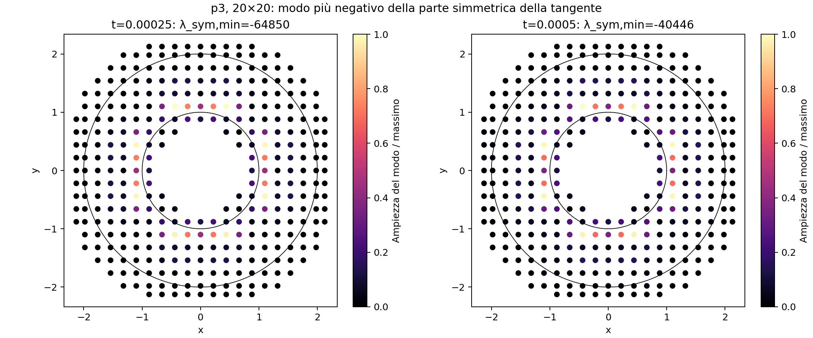
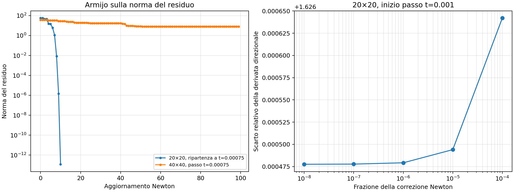

# Altre cause della mancata convergenza SBM p3

Diagnostica del 18 ottobre 2026, successiva ai
[controlli locali della Neumann](sbm_neumann_current_check.md).
Sono emersi due meccanismi distinti: un contributo di bordo che produce modi
globali con energia negativa, e una difficoltà della ricerca nonlineare in
prossimità dei cambi di ramo elastico/plastico. Nessuna prova qui riportata
fornisce ancora un ciclo misto completo e accurato.

Si usa la libreria installata già verificata, macro della legge al punto
proiettato attivo e Taylor completo 2p. Materiale, dt=0.00025, penalty-free e
tolleranze restano quelli del caso precedente, salvo le variazioni dichiarate.
Non sono state modificate conditions, sorgenti Kratos o configurazioni di
produzione. Le nuove strategie sono esclusivamente diagnostiche Python.

## 1. La perdita di positività è localizzata sul bordo Neumann

Sulla mesh 20 è stata riassemblata la matrice globale negli stati accettati
t=0.00025 e 0.0005, e nello stato non convergente a t=0.00075.
Sono stati calcolati spettro completo, valori singolari e modo minimo della
parte simmetrica `S=(K+K.T)/2`.

| Stato | Autovalori di K con parte reale negativa | Minima parte reale | Minimo autovalore di S | Condizionamento 2-norma |
|---|---:|---:|---:|---:|
| Elastico, t=0.00025 | 66 | -31713.8 | -64850.1 | 6.82e4 |
| Plastico convergente, t=0.0005 | 48 | -14831.0 | -40445.6 | 5.18e4 |
| Non convergente, t=0.00075 | 99 | -14770.5 | -29239.1 | 4.50e6 |

Per il modo elastico v normalizzato con energia minima, il contributo
`v.T*K*v` si scompone in:

| Entità | Contributo |
|---|---:|
| SolidElement, bulk | +17944.0 |
| SbmSolidCondition, Dirichlet esterna | +3.05 |
| SbmLoadSolidCondition, Neumann interna | -82797.2 |
| Totale | -64850.1 |

La ricostruzione dei contributi locali coincide con l'energia globale entro
8e-16 in termini relativi. Circa il 96% dell'ampiezza quadratica del modo
è sui DOF con r<1.3. Il modo non è quindi diffuso uniformemente nel bulk:
il contributo negativo è associato al bordo interno e supera quello positivo
degli elementi. Nel successivo stato plastico convergente il risultato è simile.



La matrice è non simmetrica. La presenza di questi modi non è, da sola,
un criterio sufficiente di mancata convergenza: il passo elastico converge.
È però una verifica più specifica della semplice osservazione di autovalori
negativi e rende concreta l'indagine sulla stabilità dell'operatore Neumann.
Non dimostra che il difetto sia intrinseco al metodo anziché a un ulteriore
aspetto della formulazione/implementazione.

Il solve lineare del controllo Newton ha errori relativi tipicamente 1e-15
sulla mesh 20. Il condizionamento peggiora nello stato fallito, ma i dati non
indicano che un errore del solver LU sia il motivo principale dell'arresto.

## 2. La strategia di ricerca modifica il blocco

Nel passo t=0.00075 che la line search standard non risolve, è stata effettuata
una ripartenza dall'ultimo stato convergente, con la stessa storia precedente
e lo stesso residuo. Newton con Armijo sulla norma del residuo raggiunge
**1.19e-13 in 10 aggiornamenti**. Questa prova a passo fissato non consolida
la storia e ripristina lo stato originale al termine della diagnostica.

È stato quindi controllato il ciclo usando una strategia diagnostica che
mantiene il solver lineare Kratos configurato e il ciclo standard di
inizializzazione/finalizzazione, ma sceglie il passo con Armijo sulla norma
del residuo. Accetta un passo soltanto con norma assoluta del residuo <1e-10
e norma della correzione Newton <1e-12; nessun passo fallito viene consolidato.

- Mesh 20: supera t=0.00075, con errore L2 0.105589, poi si blocca a t=0.001.
- Mesh 40: arriva nuovamente al limite di 100 iterazioni a t=0.00075,
  con residuo circa 8, invece di convergere.

Questo dimostra che la strategia può contribuire al blocco del singolo passo,
ma **non costituisce una soluzione del problema lungo l'intero ciclo**.



Un dettaglio concreto del codice installato: in
`structural_mechanics_solver.py`, `_create_line_search_strategy` costruisce
la strategia con il costruttore posizionale e non legge
`solving_strategy_settings.advanced_settings`. La configurazione attuale vuota
usa quindi i default C++: alpha iniziali 0.5 e 1, alpha minimo 0.1 e massimo 2,
massimo cinque iterazioni di ricerca. Aggiungere valori nel solo JSON non
li applica in questa versione.

La prova `limited_ls` costruisce direttamente la strategia con Parameters,
rendendo effettivi alpha_min=1e-4, alpha_max=1 e massimo dieci iterazioni.
Anche questa prova fallisce a t=0.00075. Il collegamento mancante degli
advanced settings è quindi reale, ma correggerlo/configurarlo non basta.

## 3. Vicino allo snervamento K non descrive necessariamente la direzione scelta

All'inizio del passo t=0.001, nel controllo sulla norma del residuo, il Newton
lineare risolve `K*d=R` con errore relativo 5.3e-15. Il modello tangente
prevede per `phi=||R||²/2` una derivata lungo d di circa **-3202.31**.
Il residuo effettivo, campionato in avanti lungo la stessa direzione, dà
invece una derivata circa **+9.97**.

Riducendo la frazione della correzione da 1e-4 a 1e-8, lo scarto fra
derivata direzionale e previsione tangente tende a circa **1.62648** in termini
relativi, anziché sparire. La direzione non è quindi di discesa per il residuo
effettivo in quel punto: ridurre semplicemente alpha non risolve questo blocco.

Nel codice J2 il passaggio tra ramo elastico e plastico usa
`trial_yield_function <= 0`. Dopo un passo plastico consolidato ci sono punti
sulla superficie di snervamento: una perturbazione positiva o negativa può
cambiare ramo e tangente. La verifica è stata corroborata con punti materiali
ausiliari che riproducono gli strain e le storie dei due punti di bordo.
Per una perturbazione di 1e-7 della correzione Newton, su 280 coppie:

| Punti ausiliari | Elastico→plastico | Plastico→elastico |
|---|---:|---:|
| Surrogate | 95 | 30 |
| True | 88 | 38 |

I conteggi riguardano il **ramo attivo della risposta tangente**, non l'assenza
o presenza di plasticità accumulata. Sono ottenuti dalle repliche indipendenti,
non da variabili private della condition, e vicino alla superficie risentono
dell'arrotondamento. La prova direzionale sul residuo globale è invece eseguita
direttamente sull'assembly effettivo.

Questo qualifica i controlli precedenti: nello stato fallito a t=0.00075,
le differenze finite del Jacobiano globale sono buone, con errore circa 9e-10
per h=1e-7 e fino a 9.5e-8 per h=1e-9. Non significa che, esattamente al cambio
di ramo all'inizio di un altro incremento, la matrice selezionata coincida con
la derivata lungo qualsiasi direzione. Non è una prova di commit errato.

La scelta del ramo/predictor vicino allo snervamento resta quindi un punto
specifico da affrontare insieme alla stabilità spaziale del bordo.

## 4. Altre variazioni controllate

| Variante | Mesh | Arresto | Ultimo errore L2 accettato |
|---|---:|---:|---:|
| Baseline line search | 20 | 0.00075 | 0.0913041 |
| Newton senza line search | 20 | 0.0005 | 0.00432264 |
| Line search configurata direttamente, alpha_max=1 | 20 | 0.00075 | 0.0913041 |
| lambda_inner=0.5 | 20 | 0.00175 | 8.78159 |
| lambda_inner=1 | 20 | 0.001 | 1249.02 |
| Otto punti di integrazione per span e direzione nel bulk | 20 | 0.00075 | 0.292500 |
| Newton con Armijo sul residuo | 20 | 0.001 | 0.105589 |
| Newton con Armijo sul residuo | 40 | 0.00075 | 0.0258129 |

Spostare il surrogate o aumentare la quadratura cambia il comportamento,
ma non produce un ciclo completo e accurato. Il solo istante di arresto non
va usato come misura del miglioramento: nelle prove con lambda più alto
l'errore cresce molto prima di Newton non convergente.

Durante il controllo il JSON di produzione ha `shape_function_derivatives_order=10`
per le conditions, mentre la baseline congelata aveva 7. È stata eseguita anche
questa variante: **stato finale, errori e conteggi delle iterazioni coincidono
esattamente con la baseline**. Per p3, 7 era già sufficiente per le derivate
usate dall'estensione completa. Gli altri valori dell'input corrispondono
alla baseline verificata.

## Dati e riproduzione

- [Esiti di tutte le varianti](diagnostics/sbm_p3_global_causes/summary.csv)
- [Spettro e contributi elastici](diagnostics/sbm_p3_global_causes/diagnostic/audit_n20/elastic/summary.json)
- [Spettro nello stato plastico](diagnostics/sbm_p3_global_causes/diagnostic/audit_n20/plastic/summary.json)
- [Spettro nello stato fallito](diagnostics/sbm_p3_global_causes/diagnostic/audit_n20/failed/summary.json)
- [Controllo globale del Jacobiano](diagnostics/sbm_p3_global_causes/diagnostic/audit_n20/failed/audit.json)
- [Ripartenza a passo fissato, senza commit](diagnostics/sbm_p3_global_causes/diagnostic/audit_n20/residual_armijo.json)
- [Derivata lungo la direzione Newton](diagnostics/sbm_p3_global_causes/residual_ls/newton_trace_n20/directional_t0.00100000.json)
- [Cambi di ramo delle repliche materiali](diagnostics/sbm_p3_global_causes/residual_ls/newton_trace_n20/branches_t0.00100000.json)
- [Parametri effettivi della line search limitata](diagnostics/sbm_p3_global_causes/limited_ls/line_search_effective_settings.json)
- [Verifiche di riproducibilità e hash](diagnostics/sbm_p3_global_causes/checks.json)
- [Snapshot del JSON di produzione](diagnostics/sbm_p3_global_causes/ProjectParameters_user_snapshot.json)

La diagnostica globale conserva esattamente esito ed errori della baseline
non strumentata. Sorgente e libreria installata mantengono gli hash registrati.
Ogni caso conserva input, log e soli campi accettati. I campi delle matrici
e dei modi sono salvati separatamente nei sottomodelli diagnostici.

```bash
OMP_NUM_THREADS=1 OPENBLAS_NUM_THREADS=1 python3 AnnulusPlasticity/diagnostics/sbm_p3_global_causes/run.py
OMP_NUM_THREADS=1 OPENBLAS_NUM_THREADS=1 python3 AnnulusPlasticity/diagnostics/sbm_p3_global_causes/run.py --variants residual_ls --spans 40
OPENBLAS_NUM_THREADS=1 python3 AnnulusPlasticity/diagnostics/sbm_p3_global_causes/postprocess.py
```
