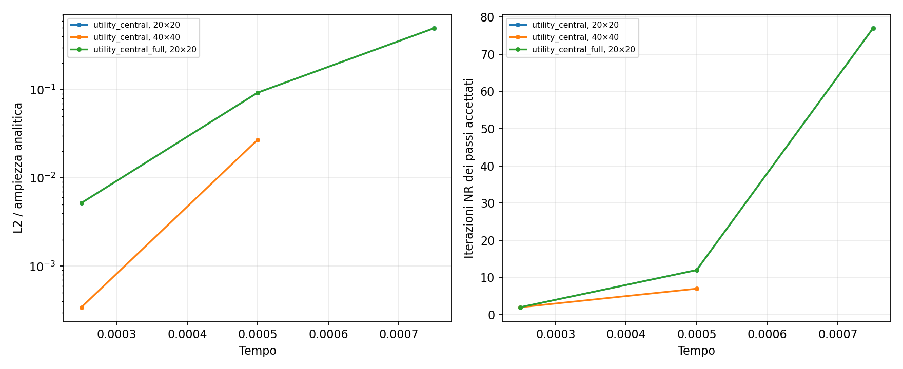

# SBM p3: scelta del ramo e TangentOperatorCalculatorUtility

**La tangente analitica risulta corretta lontano dallo snervamento. Le grandi
discrepanze direzionali locali si trovano nei punti sul fronte che cambiano ramo.**
La vera utility numerica Kratos è stata provata anche nel solver: migliora un
passo su una mesh, ma non risolve la mancata convergenza del caso.

Caso originale p3 mixed ciclico, H=10000, dt=0.00025, penalty-free,
lambda_inner=0, line search, 100 iterazioni massime. Taylor corrente q=2 nello
strain, legge al projection point attiva. Nessuna modifica alle condition,
alle librerie installate o agli input di produzione.

## Controllo locale a storia congelata

Sono ricostruite storie indipendenti con la legge nativa per tutti i punti del
volume e tutte le coppie Neumann, consolidate solo nei primi due passi accettati.
Si usano i coefficienti e gli aggiornamenti Newton effettivi del precedente audit,
con la stessa versione di sorgente/libreria verificata tramite hash.

All'inizio del passo t=0.00075 si confrontano D_alg*delta_epsilon e le differenze
finite degli stress lungo delta_epsilon=B*delta_u oppure B_true*delta_u. Sono
registrati f_trial, ramo della tangente nativa, rami perturbati avanti/indietro,
con eta=1e-6 e 1e-8. Controllo ripetuto all'iterato k=2.

| Mesh | Punti volume | Coppie Neumann | Vicini allo snervamento: volume / surrogate / true | Cambi di ramo in avanti: volume / surrogate / true |
|---|---:|---:|---|---|
| 20×20 | 2688 | 280 | 176 / 224 / 280 | 98 / 124 / 111 |
| 40×40 | 11904 | 560 | 460 / 528 / 560 | 240 / 277 / 257 |

Qui vicino allo snervamento significa |f_trial| <= 1e-8 volte la tensione di
snervamento corrente, usando f in unità di tensione equivalente. I cambi di ramo
sono rilevati dalla tangente della **legge nativa**, non soltanto dal segno di una
formula ricostruita. Sono rami attivi, non indicatori di plasticità accumulata.

Per eta=1e-8, tutte le discrepanze analitiche in avanti maggiori di 1e-3 (0.1%)
si verificano in punti vicini allo snervamento **e** con cambio di ramo:

| Mesh | Punti con discrepanza >0.1% | Di questi lontani dal fronte | Di questi senza cambio di ramo |
|---|---:|---:|---:|
| 20×20 | 332 | 0 | 0 |
| 40×40 | 773 | 0 | 0 |

Lontano dal fronte, all'inizio del passo, le mediane dell'errore relativo sono
circa 1e-8–2e-8; il massimo osservato sulla mesh40 è circa 7.2e-6.
All'iterato k=2 nessun punto è vicino al fronte e nessuno cambia ramo;
le mediane degli errori sono circa 1e-8–1e-7.

La normalizzazione locale è ||D_alg*delta_epsilon||; sono esclusi dalle statistiche
sopra i casi con norma <=1e-8, per evitare rapporti dominati da direzioni nulle.
Le storie sono confrontate con un return mapping 3D indipendente e gli stress
ripetuti dopo tutte le perturbazioni coincidono con quelli iniziali. I dettagli
sono in `local/validation_n*.json` e nei CSV per punto.

Questo identifica il cambio di ramo come origine delle grandi discrepanze locali
nei campioni controllati. Non prova che sia l'unica causa della mancata convergenza
globale: cancellazione e stabilità dell'assembly restano rilevanti.

## Richiamo della vera utility Kratos

Un modulo C++ diagnostico in /tmp espone direttamente
`TangentOperatorCalculatorUtility::CalculateTangentTensorSmallDeformationProvidedStrain`.
Le sue matrici sono confrontate con la derivata direzionale sugli stessi punti.
Non si tratta di una reimplementazione Python della utility.

Sono provate differenze in avanti (ordine 1), centrali (ordine 2), perturbazione
automatica e, su un campione locale, h=1e-10. Sul fronte una matrice costruita
perturbando separatamente le componenti può campionare rami diversi dalla direzione
Newton complessiva. La centrale può mediare carico e scarico. **Non è quindi
una matrice che deve necessariamente riprodurre ogni derivata direzionale sul
fronte.** Nei dati l'errore non migliora sistematicamente rispetto a D_alg.
Fuori dal fronte le versioni analitica e centrale concordano entro gli errori
attesi delle differenze finite.

## Prove del solver con tangente numerica

Una sottoclasse diagnostica della stessa legge tre-componenti conserva il
return mapping e la storia nativa, sostituendo solo la matrice tangente con il
risultato della vera utility. È applicata alle Properties **prima** dell'inizializzazione
di elementi e condizioni, così la prova comprende volume, surrogate e true.
Clone conserva la storia. Non sono state create nuove varianti delle condition.

Un controllo separato su sette stati di carico, scarico e inversione verifica
stress, plasticità accumulata consolidata e Clone della sottoclasse: differenze
rispetto alla legge nativa pari a zero (`bridge_validation.json`).

| Tangente | Mesh | Esito |
|---|---|---|
| Analitica originale | 20×20, 40×40 | Fallisce a t=0.00075 |
| Utility centrale, perturbazione automatica | 20×20 | Supera t=0.00075 in 77 iterazioni; poi fallisce a t=0.001 |
| Utility centrale, perturbazione automatica | 40×40 | Fallisce a t=0.00075 |
| Utility in avanti, perturbazione automatica | 20×20 | Fallisce a t=0.00075 |
| Utility centrale, h=1e-10 | 20×20 | Fallisce a t=0.00075 |

Con perturbazione automatica la utility usa la propria selezione dipendente
dallo strain, con soglia minima 1e-8 in assenza di PERTURBATION_SIZE. La prova
h=1e-10 impone esplicitamente tale proprietà nella copia diagnostica.

Nel passo recuperato della mesh20 l'errore L2 è **0.4964** rispetto all'ampiezza
analitica del primo picco; H1 bulk è 0.7346. Non è un recupero di accuratezza
soddisfacente. Il run prolungato riproduce esattamente gli stessi primi tre passi,
poi fallisce al primo picco di carico t=0.001. Nessun errore del passo fallito
viene usato come risultato di convergenza.



I risultati indicano che la utility può cambiare il percorso di Newton attraverso
una regolarizzazione numerica dipendente dalla perturbazione. Non emerge una
correzione generale ottenibile sostituendo semplicemente la tangente analitica.

## Artefatti e riproduzione

Cartella: [diagnostics/sbm_p3_material_tangent](diagnostics/sbm_p3_material_tangent).

- `bridge.cpp`, `build_bridge.py`: richiamo della utility e sottoclasse sperimentale;
- `check_bridge.py`, `bridge_validation.json`: stress, storia e Clone;
- `local/points_n*.csv`: f_trial, rami e confronti per punto e direzione;
- `local_counts.json`, `local_statistics.json`: conteggi e statistiche;
- `solver_summary.json`: esiti dei cinque esperimenti con utility;
- `utility_*/new/spans_*/`: log, input congelati e metriche dei passi accettati;
- `build.json`, `bridge.json`: versioni e librerie effettivamente utilizzate.

Lo status `failed` dei processi `local` è un arresto diagnostico intenzionale
successivo al completamento dell'audit; non è un nuovo fallimento Newton.
Gli status dei processi `utility_*` sono invece quelli effettivi del solver.

```sh
OMP_NUM_THREADS=1 OPENBLAS_NUM_THREADS=1 python3 AnnulusPlasticity/diagnostics/sbm_p3_material_tangent/run.py
OMP_NUM_THREADS=1 OPENBLAS_NUM_THREADS=1 python3 AnnulusPlasticity/diagnostics/sbm_p3_material_tangent/followup.py
OMP_NUM_THREADS=1 OPENBLAS_NUM_THREADS=1 python3 AnnulusPlasticity/diagnostics/sbm_p3_material_tangent/check_bridge.py
MPLCONFIGDIR=/tmp/sbm-material-mpl python3 AnnulusPlasticity/diagnostics/sbm_p3_material_tangent/postprocess.py
```

Il primo comando verifica gli hash del precedente audit, riusa i suoi input
congelati e ricompila il modulo temporaneo usando i flag Kratos esistenti.
Le prove locali richiedono gli iterati salvati in `sbm_p3_directional_warm_start`.
Nessuna libreria viene installata. Gli output della cartella diagnostica vengono
sovrascritti in una nuova esecuzione.
