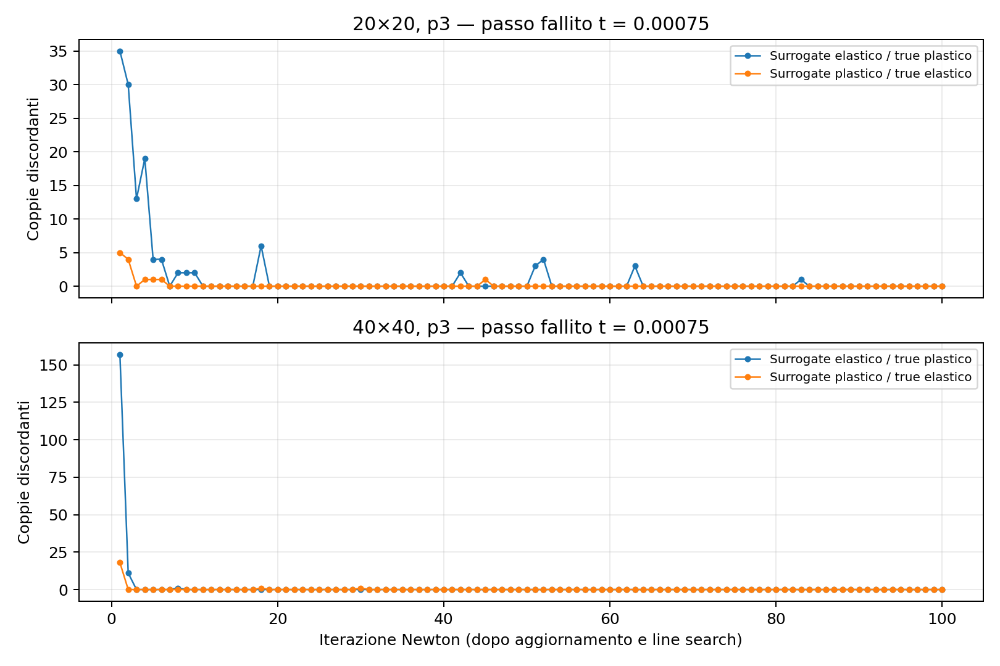

# Coppie surrogate–projection point nei fallimenti SBM p3

Controllo sul caso ciclico mixed attuale, mesh 20×20 e 40×40, p3,
H=10000, lambda_inner=0, dt=0.00025, line search, massimo 100 iterazioni.
Legge al projection point attiva, Taylor completo. Nessuna modifica alle condition.
Entrambe le mesh convergono ai primi due passi e falliscono a t=0.00075.

## Risultati

I conteggi seguenti distinguono il ramo elastico/plastico **attivo nella risposta
trial** dalla plasticità accumulata nella storia del materiale.

| Mesh | Coppie Neumann | Iterazioni fallite con coppie discordanti / 100 | Massimo S elastico / T plastico | Massimo S plastico / T elastico | Coppie discordanti all'ultima iterazione |
|---|---:|---:|---:|---:|---:|
| 20×20 | 280 | 16 | 35 | 5 | 0 |
| 40×40 | 560 | 5 | 157 | 18 | 0 |

I due massimi sono calcolati separatamente sull'intero passo. Tutte le coppie
sono attivamente plastiche nell'ultima iterazione fallita di entrambe le mesh.
Durante le iterazioni precedenti esistono invece entrambe le direzioni di
discordanza, anche lontano dalla tolleranza di snervamento.

Nel passo **convergente** precedente, t=0.0005, ci sono già 64 coppie
S elastico / T plastico sulla mesh 20 e 48 sulla mesh 40; nessuna coppia inversa.
Il primo passo t=0.00025 è interamente elastico.

Quindi la discordanza di ramo esiste durante i passi problematici, ma esiste
anche in uno stato convergente. Non basta a spiegare il fallimento. L'assenza
di discordanza all'ultima iterazione non esclude che precedenti cambi di ramo
abbiano influenzato il percorso di Newton: questo controllo non dimostra una
relazione causale.

Le storie restano diverse anche quando entrambi i punti sono attivamente
plastici: all'inizio del passo fallito, 64 coppie sulla mesh 20 e 48 sulla 40
hanno plasticità accumulata positiva solo al true. Questo non equivale a una
discordanza di ramo attivo al termine del passo.



## Come è stato verificato

- Salvati gli iterati della strategia Kratos nativa mediante
  `SetUpNonconvergedSolutionsFlag` e `GetNonconvergedSolutions`: stato iniziale
  più spostamenti dopo ciascun aggiornamento Newton/line search. Non comprende
  i sottotentativi interni della line search.
- Ricostruite due storie costitutive indipendenti per ogni coppia con le
  deformazioni al surrogate e al true, aggiornate solo dopo i passi convergenti.
  Nessuno stato fallito viene consolidato.
- Risposte della legge J2 nativa confrontate con un return mapping 3D indipendente;
  errori assoluti massimi sugli stress inferiori a 8.4e-12. Residui locali e
  tangenti effettivi della condition concordano con le due risposte ricostruite:
  errori normalizzati massimi 3.4e-14 e 4.3e-15 rispettivamente negli snapshot.
- Il grafico usa solo discordanza robusta: f_trial < -tol da un lato e
  f_trial > tol dall'altro, tol=1e-8 volte la scala della tensione di snervamento.
  Lo stato iniziale di ciascun passo è escluso dal conteggio delle 100 iterazioni:
  i punti plastici consolidati sono sullo snervamento e i flag di tangente possono
  dipendere dall'arrotondamento. Al passo fallito, iterazione 0, tutte le coppie
  sono entro tolleranza almeno su un lato.
- Esito, numero di iterazioni ed errori dei passi accettati coincidono esattamente
  con il precedente run nativo senza questo audit.

## Artefatti e riproduzione

Cartella: [diagnostics/sbm_p3_pair_phases](diagnostics/sbm_p3_pair_phases).
Input congelati in `parameters_input.json` e `materials_input.json`;
versione di sorgente e libreria identificata tramite SHA256 in `build.json`.

Per ciascuna mesh, `audit_n20` / `audit_n40` contengono:

- `steps.json`: riepilogo degli stati finali di ciascun passo;
- `pairs_t*.csv`: coordinate, rami, funzioni di snervamento e storie di ogni coppia;
- `iterations_t*.csv`: conteggi per iterazione;
- `iteration_pairs_t*.csv`: classificazione e funzioni di snervamento per coppia e iterazione.

Dalla root del repository:

```sh
OMP_NUM_THREADS=1 OPENBLAS_NUM_THREADS=1 python3 AnnulusPlasticity/diagnostics/sbm_p3_pair_phases/run.py
python3 AnnulusPlasticity/diagnostics/sbm_p3_pair_phases/postprocess.py
```

`run.py` verifica gli hash della versione esaminata e acquisisce gli input di
produzione correnti; un nuovo avvio sovrascrive gli input e gli output dell'audit.
