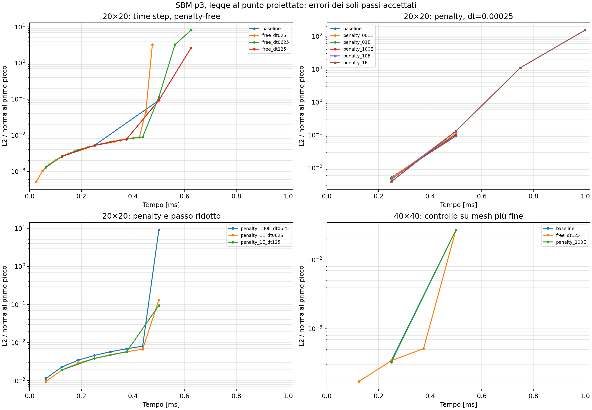

# SBM p3: sensibilità a time step e penalizzazione

Prove eseguite il 18 ottobre 2026 con la **formulazione nuova**, cioè
`SBM_USE_PROJECTION_POINT_CONSTITUTIVE_LAW` attivo. Sono state eseguite 13 nuove
prove, confrontate con le due baseline p3 sulle mesh 20 e 40 del
[precedente confronto](sbm_cyclic_old_vs_new_p3_check.md).

**Nessuna delle configurazioni provate completa il ciclo con una soluzione
attendibile.** Ridurre il passo e introdurre la penalty modifica il punto di
arresto, ma non elimina il problema. La maggiore durata del caso penalty E
nasconde una crescita enorme dell'errore, già prima del primo scarico.

## Condizioni comuni e significato della penalty

Restano invariati p3, carico ciclico analitico, H=10000, E=67000, nu=0,
line search, massimo 100 iterazioni, tolleranze, quadratura di default,
lambda_inner=0 e lambda_outer=0.5. Fine ciclo prevista a t=0.006.
La mesh principale è 20×20; due modifiche sono state controllate anche sulla 40×40.
Le verifiche sui file effettivamente usati confermano che cambiano soltanto
time step e `PENALTY_FACTOR`, oltre al raffinamento esplicitamente indicato.

Nel codice `PENALTY_FACTOR=-1` imposta penalty nulla e segno adjoint -1.
Un valore positivo attiva il termine penalty e segno adjoint +1: cambia quindi
anche la formulazione adjoint. In 2D il codice imposta l'ordine Taylor completo
a 2p; la penalty effettivamente assemblata è `(2p)^2 * PENALTY_FACTOR / h`,
quindi per p3 è `36 * PENALTY_FACTOR / h`.

La penalty interviene sulle condizioni **Dirichlet del bordo esterno**.
Il bordo interno misto mantiene `SbmLoadSolidCondition` di Neumann, senza un
nuovo termine penalty. Queste prove non stabilizzano direttamente tale bordo.

Sono state riutilizzate le librerie temporanee verificate del confronto p3.
Nessun sorgente Kratos, libreria installata o parametro di produzione è stato
modificato; non sono state implementate altre varianti della condition.

## Risultati sulla mesh 20×20

L'errore riportato è L2 normalizzato con la norma analitica al primo picco,
misurato nell'ultimo passo accettato. Non sono calcolati errori sul passo fallito.

| PENALTY_FACTOR | dt | Arresto Newton | Ultimo tempo accettato | Ultimo errore L2 |
|---|---:|---:|---:|---:|
| -1, baseline | 0.00025 | 0.00075 | 0.0005 | 0.0925353 |
| -1 | 0.000125 | 0.00075 | 0.000625 | 2.61458 |
| -1 | 0.0000625 | 0.0006875 | 0.000625 | 8.06425 |
| -1 | 0.000025 | 0.0005 | 0.000475 | 3.21642 |
| 0.01 E = 670 | 0.00025 | 0.00075 | 0.0005 | 0.111924 |
| 0.1 E = 6700 | 0.00025 | 0.0005 | 0.00025 | 0.00515441 |
| E = 67000 | 0.00025 | 0.00375 | 0.0035 | 2.36222e15 |
| 10 E = 670000 | 0.00025 | 0.00075 | 0.0005 | 0.130184 |
| 100 E = 6700000 | 0.00025 | 0.00075 | 0.0005 | 0.102989 |
| E | 0.000125 | 0.000625 | 0.0005 | 0.0944287 |
| E | 0.0000625 | 0.0005625 | 0.0005 | 0.131490 |
| 100 E | 0.0000625 | 0.0005625 | 0.0005 | 9.03451 |

Il caso penalty E con passo originale è l'unico a superare il primo picco:
a t=0.001 ha già errore L2 **151.99**, poi arriva a 2.36e15 prima dell'arresto.
L'accettazione del passo da parte del solver non costituisce una verifica
dell'accuratezza o della stabilità della soluzione discreta.



## Controllo sulla mesh 40×40

| PENALTY_FACTOR | dt | Arresto Newton | Ultimo errore L2, a t=0.0005 |
|---|---:|---:|---:|
| -1, baseline | 0.00025 | 0.00075 | 0.0271067 |
| -1 | 0.000125 | 0.000625 | 0.0271067 |
| 100 E | 0.00025 | 0.00075 | 0.0270136 |

Anche su questa mesh le due modifiche non risolvono il problema. La piccola
riduzione dell'errore con penalty 100E non evita il successivo arresto.

## Jacobiano e spettro: controllo aggiuntivo

Una ripetizione isolata della baseline nuova sulla mesh 20 ha controllato
la matrice assemblata rispetto alla derivata numerica del residuo, mantenendo
fissa la storia costitutiva precedente. Sono state usate tre direzioni casuali
e differenze centrali con h=1e-7, 1e-8 e 1e-9.

- A t=0.0005, stato convergente: scarto relativo massimo circa **1.95e-9**;
  con h=1e-7, circa 3e-11.
- A t=0.00075, stato dell'iterazione 100 non convergente: scarto massimo circa
  **3.59e-8**; con h=1e-7, circa 3.4e-10.

Nei punti controllati il Jacobiano della formulazione nuova risulta quindi
coerente con il residuo. Questo controllo non verifica da solo tutta la
formulazione spaziale né garantisce convergenza di Newton.

Lo spettro completo delle matrici 672×672 mostra:

| Stato | Minima parte reale degli autovalori | Autovalori con parte reale negativa |
|---|---:|---:|
| t=0.00025, elastico | -35621.6 | 84 |
| t=0.0005, convergente | -19076.4 | 56 |
| t=0.00075, non convergente | -15467.7 | 97 |

La soglia del conteggio è `1e-9 * max(abs(eigenvalues))`. La matrice del primo
passo coincide esattamente con quella riassemblata a spostamento nullo:
questi autovalori negativi sono quindi già presenti nell'operatore elastico
p3 di questa configurazione. Le matrici sono non simmetriche: i dati non
vanno interpretati come un criterio sufficiente di fallimento di Newton.
Infatti il primo passo elastico converge comunque in due iterazioni.

La legge indipendente al punto proiettato rende coerente la risposta materiale
nel punto usato per il flusso, ma non garantisce da sola stabilità dell'intero
operatore SBM per qualsiasi grado e distanza dal bordo. Queste prove non
dimostrano che il problema p3 sia intrinseco al metodo: indicano di verificare
anche l'operatore spaziale, in particolare l'estensione di ordine elevato
e il bordo Neumann. Non emerge una correzione ottenibile semplicemente
riducendo dt o cambiando la penalty esterna nei valori esplorati.

## Artefatti e riproduzione

- [Tabella completa, 15 configurazioni](diagnostics/sbm_p3_sensitivity/summary.csv)
- [Errori di ogni passo accettato](diagnostics/sbm_p3_sensitivity/errors_by_time.csv)
- [Confronto degli errori](diagnostics/sbm_p3_sensitivity/sensitivity.png)
- [Tempi raggiunti](diagnostics/sbm_p3_sensitivity/availability.png)
- [Verifiche di parametri, materiali e file Kratos](diagnostics/sbm_p3_sensitivity/checks.json)
- [Audit Jacobiano allo stato convergente](diagnostics/sbm_p3_sensitivity/jacobian_check/converged_state/audit.json)
- [Audit Jacobiano allo stato non convergente](diagnostics/sbm_p3_sensitivity/jacobian_check/failed_state/audit.json)
- [Spettri](diagnostics/sbm_p3_sensitivity/jacobian_check/spectra.json)

Ogni sottocartella contiene input congelati, `result.json`, `run.log`,
parametri/materiali effettivi e l'ultimo campo convergente `solution.npz`.
Gli input di produzione rimangono invariati.

```bash
OMP_NUM_THREADS=1 OPENBLAS_NUM_THREADS=1 python3 AnnulusPlasticity/diagnostics/sbm_p3_sensitivity/run.py
OMP_NUM_THREADS=1 OPENBLAS_NUM_THREADS=1 python3 AnnulusPlasticity/diagnostics/sbm_p3_sensitivity/run.py --spans 40 --variants free_dt125 penalty_100E
LD_PRELOAD=/tmp/sbm_cyclic_old_vs_new_p3/new/libKratosIgaCore.so OMP_NUM_THREADS=1 OPENBLAS_NUM_THREADS=1 python3 AnnulusPlasticity/diagnostics/sbm_p3_sensitivity/audit.py
OPENBLAS_NUM_THREADS=1 python3 AnnulusPlasticity/diagnostics/sbm_p3_sensitivity/postprocess.py
```

La libreria temporanea deve esistere e corrispondere agli hash registrati;
il driver verifica anche che sorgente e libreria installata coincidano con
il confronto originale. Il codice Python dei tre script passa `py_compile`.
