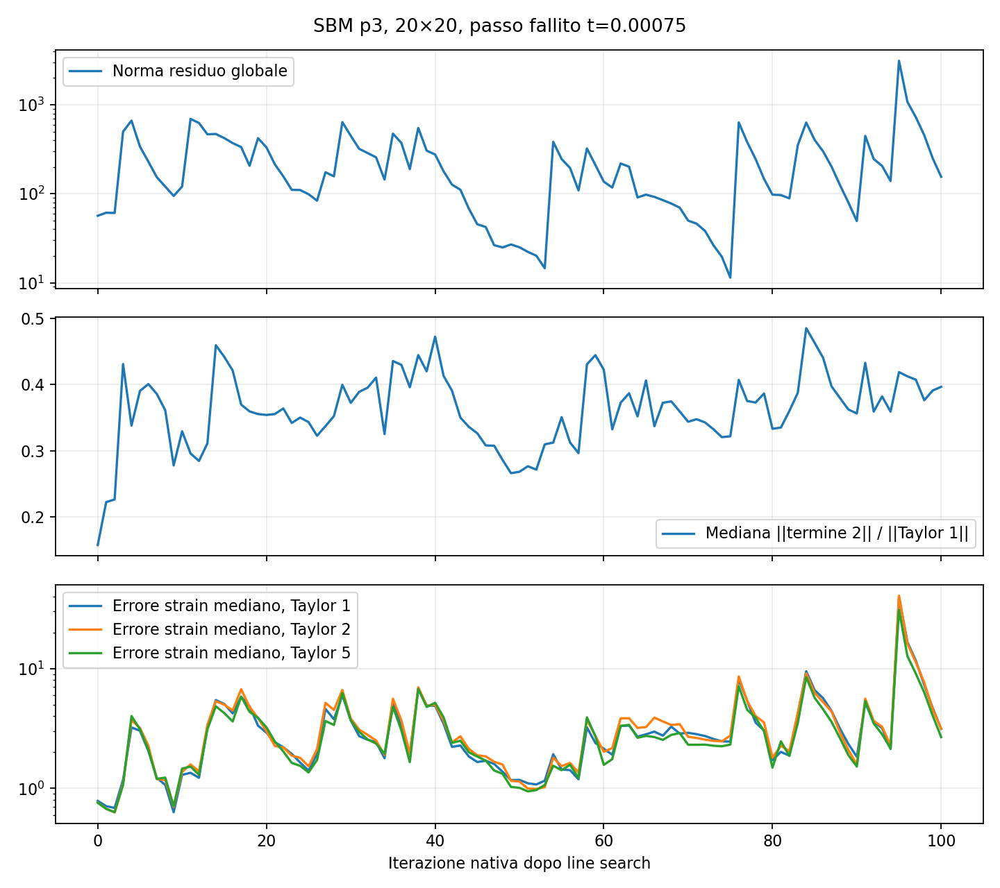
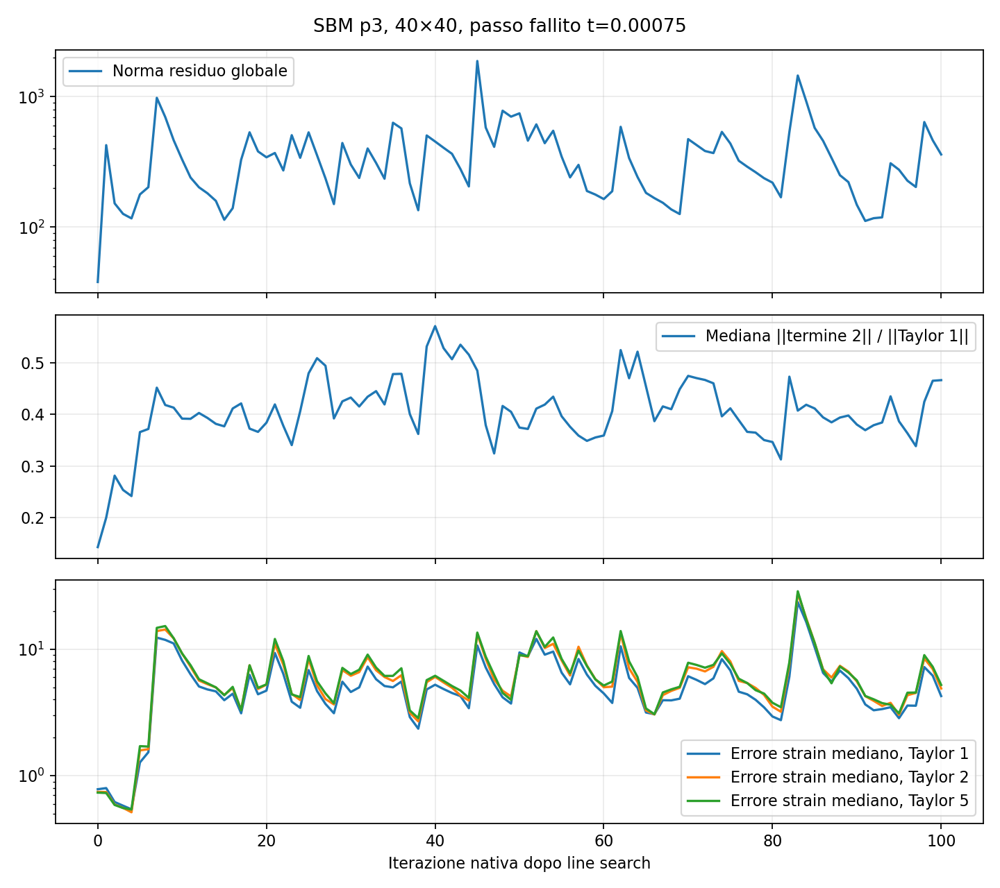

# SBM p3: strain Taylor nelle iterazioni non convergenti

Eseguiti quattro run sulla versione corrente: nativo e strumentato, per mesh
20×20 e 40×40. Caso ciclico mixed, dt=0.00025, H=10000, penalty-free,
lambda_inner=0, line search, massimo 100 iterazioni. Legge indipendente al true
attiva. Nessuna modifica a condition, libreria o input di produzione.

La versione corrente usa **q=2 nello strain per p=3**: derivate dello spostamento
fino all'ordine 3. Non è la precedente versione con Taylor tensoriale completo.
Sorgente congelato e hash di sorgente/libreria in
[diagnostics/sbm_p3_taylor_iterations/build.json](diagnostics/sbm_p3_taylor_iterations/build.json).

## Esiti

In entrambe le mesh convergono t=0.00025 e t=0.0005, poi fallisce t=0.00075
alla centesima iterazione. Esiti, iterazioni ed errori dei passi accettati sono
**esattamente identici** tra run nativo e strumentato.

Separando epsilon_T2 = epsilon_s + termine_1 + termine_2, il rapporto considerato
è ||termine_2|| / ||epsilon_s + termine_1||, calcolato per coppia.
Le mediane all'ultima iterazione di ciascun passo sono:

| Mesh | Elastico, t=0.00025 | Convergente, t=0.0005 | Fallito, t=0.00075 | Coppie con rapporto >1 al fallimento |
|---|---:|---:|---:|---:|
| 20×20 | 4.14% | 15.70% | 39.66% | 46/280 |
| 40×40 | 1.44% | 14.28% | 46.66% | 140/560 |

Nel passo fallito le mediane raggiungono picchi del 48.54% e 57.13%.
I residui globali finali sono 155.17 e 360.80, contro meno di 1e-13 nei passi
accettati. L'aumento dei termini superiori accompagna la perdita di accuratezza,
ma **non dimostra che ne sia la causa iniziale**: sono misurati sugli iterati
prodotti dal metodo, che nel frattempo si allontanano dalla soluzione.

In particolare, già al primo aggiornamento della mesh40 il residuo passa da
37.97 a 425.34, mentre il rapporto mediano sale da 14.28% a 20.00%.
Non emerge quindi una soglia universale del rapporto che determini il fallimento.

## Fronte esatto e knot

A t=0.00075 nessuno dei segmenti attraversa il fronte plastico **esatto**:
sono tutti nella regione plastica liscia della soluzione analitica.
A t=0.0005, che converge, gli attraversamenti sono invece 280/280 e 352/560.
Questo indicatore non descrive i fronti numerici durante Newton, né esclude
l'influenza della storia del passo precedente.

Gli attraversamenti di linee di knot sono 144/280 e 264/560, costanti nei passi.
Gli errori finali dello strain esteso q=2, rispetto allo strain esatto al true,
sono elevati in **entrambi** i gruppi:

| Mesh | Mediana senza attraversare knot | Mediana attraversando knot |
|---|---:|---:|
| 20×20 | 238.65% | 474.55% |
| 40×40 | 388.67% | 643.66% |

Quindi l'attraversamento di knot non è necessario per osservare un forte errore.
Il gruppo senza attraversamento non contiene un salto di derivata dovuto a knot
nell'interno del segmento. La maggiore mediana del gruppo attraversante, da sola,
non separa l'effetto dei knot da distanza, direzione ed errore del campo di partenza.

La valutazione della spline globale al true richiederebbe coefficienti eliminati
nel dominio del foro: mancano coefficienti di supporto su tutte le coppie.
Il controllo li registra e **non attribuisce loro valori fittizi**; non riportiamo
quindi differenze con una presunta spline globale completa al true.

## Accuratezza della ricostruzione discreta

Sullo stesso campo nodale del run q=2, sono stati valutati a posteriori i Taylor
q=1, q=2 e q=5. q=5 ricostruisce l'intero polinomio locale bicubico esteso.
La valutazione diretta indipendente tramite polinomi SciPy concorda con q=5:
errore relativo massimo su tutti gli iterati inferiore a 1.4e-12.
Non c'è evidenza di un errore nei coefficienti/fattoriali della ricostruzione
controllata. q=2 è una troncatura di quella continuazione polinomiale.

| Mesh | Errore strain mediano q=1 | q=2 effettivo | q=5 a posteriori |
|---|---:|---:|---:|
| 20×20, fallimento | 313.35% | 315.20% | 268.06% |
| 40×40, fallimento | 426.53% | 489.48% | 522.07% |

Aumentare l'ordine non recupera sistematicamente la soluzione esatta quando
il campo discreto di partenza è già errato. Questi confronti **non sono nuovi
solve con q=1 o q=5** e non ne predicono la convergenza.

Le norme sopra sono euclidee sul vettore ingegneristico
[epsilon_xx, epsilon_yy, gamma_xy], normalizzate con lo strain esatto al true.
Non sono errori L2 di dominio. I rapporti fra termini possono essere amplificati
anche da cancellazioni nel denominatore.

## Verifiche e grafici

Per ogni coppia sono mantenute due storie J2 indipendenti, consolidate solo dopo
passi convergenti. Negli snapshot residui e tangenti ricostruiti concordano con
quelli effettivi delle condition (errori normalizzati <4.7e-14 e <2.0e-14),
e gli stress con il return mapping 3D indipendente (errore assoluto <8.2e-12).
Questo verifica anche quale strain esteso usa realmente la libreria.

Gli iterati sono quelli salvati dalla strategia nativa, dopo line search;
non includono i sottotentativi interni della line search. Il riesame ripristina
spostamenti e risposte trial e non consolida stati falliti.





Gli script e i CSV per coppia/iterazione sono in
[diagnostics/sbm_p3_taylor_iterations](diagnostics/sbm_p3_taylor_iterations).
`summary.json` contiene anche correlazioni descrittive e suddivisioni per knot.

Riproduzione dalla root, con la stessa versione attuale del sorgente:

```sh
OMP_NUM_THREADS=1 OPENBLAS_NUM_THREADS=1 python3 AnnulusPlasticity/diagnostics/sbm_p3_taylor_iterations/run.py
MPLCONFIGDIR=/tmp/sbm-taylor-mpl python3 AnnulusPlasticity/diagnostics/sbm_p3_taylor_iterations/postprocess.py
```

Il runner acquisisce nuovamente gli input e sovrascrive gli output della propria
cartella; controlla che gli hash di sorgente e libreria restino invariati durante
i test. Gli output `baseline` e `audit` sono tenuti separati.

## Interpretazione

La perdita di regolarità dello strain esatto al fronte è reale, ma il fallimento
qui non si verifica mentre i segmenti attraversano quel fronte. Non basta nemmeno
attraversare un knot per spiegare il fenomeno. I risultati sono compatibili con
amplificazione dell'estensione e difficoltà del sistema non lineare, senza
identificarne un'unica causa. Per un'attribuzione causale servirebbe confrontare
operatori a parità di stato e storia, oppure effettuare solve controllati con
ordini diversi: non sono state introdotte nuove varianti della condition.
