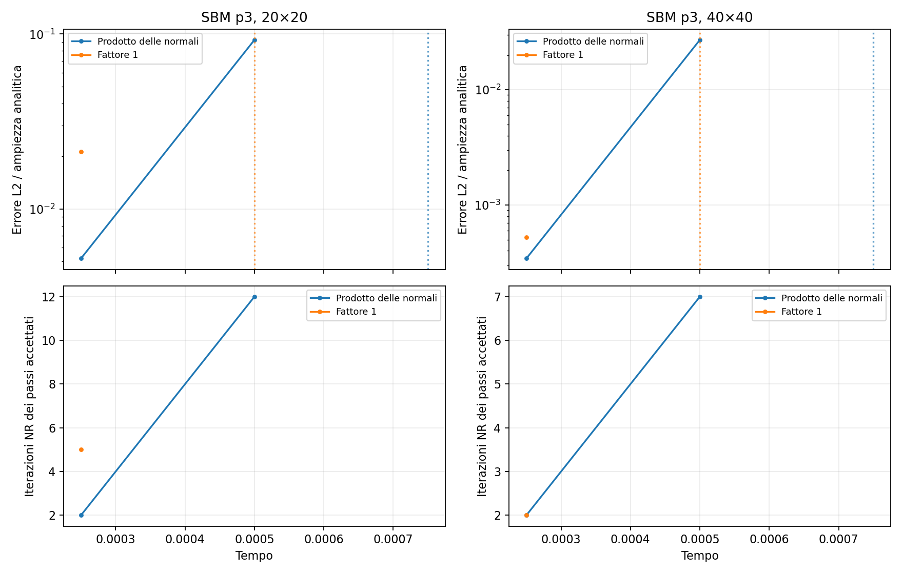

# SBM p3: sostituzione del prodotto delle normali con 1

**Il fattore 1 peggiora la convergenza su entrambe le mesh provate:** il
fallimento passa da t=0.00075 a t=0.0005. Non risolve l'oscillazione osservata.

Sono stati eseguiti quattro run nativi: riferimento e variante, per mesh 20×20
e 40×40. Caso ciclico mixed corrente, p3, dt=0.00025, H=10000, penalty-free,
lambda_inner=0, line search, massimo 100 iterazioni. Legge al projection point
attiva e Taylor corrente q=2 nello strain. Stessi input in ogni confronto.

## Modifica effettivamente provata

È stata compilata una vera libreria C++ sperimentale in
`/tmp/sbm_p3_unit_normal_factor/libKratosIgaCore.so`, caricata nei processi della
variante mediante LD_PRELOAD. Tre sostituzioni nell'assembly:

- tangente del termine di stress al true: fattore 1;
- carico prescritto nel residuo: fattore 1;
- sottrazione dello stress al true nel residuo: fattore 1.

Quindi residuo e tangente sono modificati coerentemente. Le normali nelle
trazioni sigma*n e nella definizione del dato fisico sono conservate.
Non si tratta di un cambiamento dei soli dati Python. Non è stata cambiata
la scelta della legge costitutiva al projection point.

Sorgente esterno e libreria installata non sono stati modificati. Gli hash sono
stati controllati anche alla fine dei run. Il riferimento coincide esattamente,
per esiti e metriche, con il baseline del precedente audit Taylor corrente.

## Risultati

| Mesh | Fattore originale: arresto | Fattore 1: arresto | Passi completati originale / 1 |
|---|---:|---:|---:|
| 20×20 | 0.00075 | 0.00050 | 2 / 1 |
| 40×40 | 0.00075 | 0.00050 | 2 / 1 |

Confronto dell'errore L2 normalizzato con l'ampiezza analitica al medesimo tempo
accettato t=0.00025:

| Mesh | Prodotto delle normali | Fattore 1 | Iterazioni NR originale / 1 |
|---|---:|---:|---:|
| 20×20 | 0.5201% | 2.1264% | 2 / 5 |
| 40×40 | 0.03431% | 0.05255% | 2 / 2 |

Gli errori dei passi falliti non vengono calcolati. Confrontare l'ultimo errore
accettato di due run che si fermano a tempi diversi sarebbe fuorviante;
`common_steps.json` contiene solo confronti a tempi uguali.



## Interpretazione e limiti

L'ipotesi che basti eliminare il prodotto delle normali per recuperare Newton
non è supportata da queste prove. Il fattore influenza il comportamento, ma
portarlo a 1 sposta il fallimento a un passo precedente su entrambe le mesh.
Questo non dimostra, da solo, la correttezza teorica della formulazione originale.

Restano da distinguere la stabilità dell'operatore globale con estensione e
il comportamento di Newton ai cambi di ramo costitutivo. I precedenti controlli
mostrano tangenti coerenti con i residui negli stati lontani dal cambio di ramo;
questo non garantisce la convergenza del sistema non lineare non liscio.
La presente prova non attribuisce una causa unica al fallimento.

## Artefatti e riproduzione

Cartella: [diagnostics/sbm_p3_unit_normal_factor](diagnostics/sbm_p3_unit_normal_factor).

- [Patch sperimentale](diagnostics/sbm_p3_unit_normal_factor/unit_normal_factor.patch).
- `source_original.cpp` e `source_unit_factor.cpp`: copie esatte dei sorgenti confrontati.
- `build.json`: hash, librerie caricate e significato delle varianti.
- `parameters_input.json`, `materials_input.json`: input congelati.
- `summary.csv`, `summary.json`, `common_steps.json`: risultati numerici.
- `old/spans_*`: riferimento attuale; `new/spans_*`: fattore 1.
  Qui old/new sono etichette del runner condiviso, **non** la precedente
  distinzione fra legge al surrogate e legge al true.

Dalla root del repository:

```sh
OMP_NUM_THREADS=1 OPENBLAS_NUM_THREADS=1 python3 AnnulusPlasticity/diagnostics/sbm_p3_unit_normal_factor/run.py
MPLCONFIGDIR=/tmp/sbm-unit-mpl python3 AnnulusPlasticity/diagnostics/sbm_p3_unit_normal_factor/postprocess.py
```

Il runner ricompila solo la condition e ricollega la libreria sperimentale usando
la configurazione di build Kratos esistente. Non installa librerie. Acquisisce
nuovamente gli input correnti e sovrascrive gli output della propria cartella.
